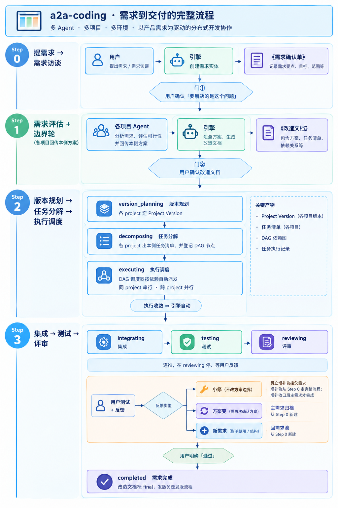
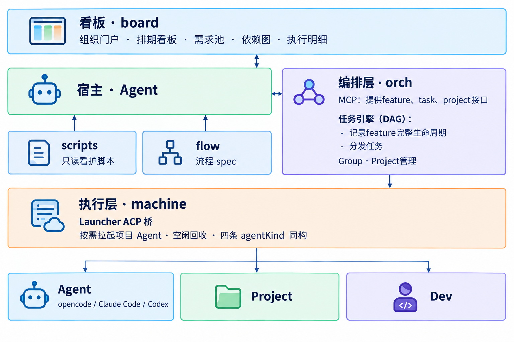

# a2a-coding

## 这个项目是什么

**一个产品，往往不是一个仓库。** 
> 它由前端、后端、中台等多个独立项目构成；前端还可能有 Web / 移动 / 桌面等若干客户端，各自又要跑在不同的环境里。每个项目有自己的代码仓、自己的工具链、自己机器上的运行时 —— 所以「实现一条需求」天然就是一件跨项目、跨环境的事。

本项目要解决的就是这个结构下的协作：**把这些项目编成一个「项目组」，面向同一条产品需求共同推进。**

- **组织单位是「产品需求」，不是某个仓库、某个 agent。** 需求进入项目组后，组内各项目按各自职责参与：各自评估接不接、各自出本侧方案、各自拆自己的任务；流程走到哪一步、下一步该谁做什么，由引擎的状态机约束，不靠人记，也不靠约定。
- **执行仍然归各项目自己。** 每条需求的实现都落在具体项目的具体工作区上，由该项目自己的 Code Agent 执行；这些 agent 可以在同一台机器，也可以分散在不同机器。
- **组是有边界的。** 一个项目组的成员是「某台机器上的某个项目」，编排侧只连、只用组内成员：这条产品线的项目，与另一条产品线的项目互不串台。

这样「跨机、跨项目」就不是额外加的功能，而是「一个产品由多个项目组成」这个事实的直接结果：同一条需求会同时触达前端与后端，各自落各自的版本，而人只需要面对需求本身。

## 一条需求走完的链路

## 项目做了什么

图中五个单元各管一段，边界互不重叠：

| 单元 | 分工 | 
|---|---|
| **board** 板 / Web 操作端 | 人机界面：提需求、触发一轮对话、确认方案、排期，管理产品及项目成员 | 
| **orch** 编排单元 | 工具面 + 调度内核：需求状态机、任务 DAG 调度（同 project 串行 / 跨 project 并行）、会话 / 任务 / 两级版本台账、只读数据面，以MCP形式对宿主agent提供接入 |
| **flow** 规范包 | 需求流程规范内核：整体流程骨架、每步判据与产出物、四个职责位、版本与发版纪律 |
| **scripts** 宿主侧脚本 | feature、task的只读看护工具：只读等待一个需求 / 若干任务到「需宿主动作」的时点 | 
| **machine** 执行单元 | 每台执行机器常驻：Launcher（Runner）出站注册、长轮询领任务、按需拉起本机项目 Agent、空闲回收、结果回传；通过 ACP桥 让执行层同构 | 

## 能解决什么问题

| 你会遇到的问题 | 本项目的做法 | 你得到的 |
|---|---|---|
| 需求散落在各端对话里，走到哪一步、下一步该谁做全靠人记 | 需求入引擎即成一等对象：状态机主链 + 两道用户门 + 步骤产出物强制落文件并登记 | 流程状态可查、可追溯；「跳步 / 提前实现」在引擎层被结构化拒绝 |
| 一个需求要同时动前端、后端、中台（前端还分多端），跨仓跨机协调靠喊 | 需求带归属（触达哪些 project、各进哪个 Project Version）；DAG 调度按依赖跨项目派发 | 一条需求一条链、多项目并行推进，边界轮逐项表态留痕 |
| Agent 散在各台机器、各个项目上，只能靠手工切 | 「项目 → 机器」静态映射 + 每机常驻 Launcher 按需拉起、空闲回收 | 一次派发即可，不用关心中间是谁在执行 |
| 长任务容易超时，失败之后没人收口，整单跟着烂 | 半异步返回句柄 + 后台看护落库；失败只冻结依赖闭包、按类分流、有界续跑、可重派解冻 | 局部失败不连坐；失败是「停住等你裁量」，不是「一锅端」 |
| 版本 / 交付账说不清：这个版本有哪些需求、各落到哪个项目、发版到底发了什么 | 两级版本台账 + 归属记录 + 发版一个动作级联 + 已发版冻结 | 版本面有单一事实源，板和引擎读的是同一份 |
| Agent 权限不可控，怕它乱改 | 项目级 `risk` 三档（`read` / `write` / `full`）映射到各后端的会话模式 | 按项目收放权限，默认可写、只读档真只读 |
| 想看见进展，不想翻日志 | 板：排期看板 / 需求池 / 依赖图（按真实依赖边绘制）/ 执行明细（含「为什么没跑」） | 人和引擎看同一份事实 |
| 手里的流程规范搬不到别的项目用 | `flow/` 规范包 + 旁路引入脚本 | 规范可整体复制、可还原、不侵入目标项目 |

### 当前的边界（本项目暂时不解决的）

- **跨机鉴权尚未实现**（计划反向代理 TLS + Bearer，预留 mTLS）；本地 A2A 端点默认没有入站鉴权。
- **执行层 ACP 桥的任务台账是纯内存**：在途任务不落盘，进程中断后不保留原始结果，需重新发起或重试（编排侧终态结果持久在 SQLite，不丢）。
- **「多实例 + 工作区隔离」「设备本身当 Agent」只留了扩展点**，本版本未实现。

### 部署形态

「机器」是一个逻辑单位，可以是远端主机，也可以是本机；「项目 → 机器」的映射全部来自静态配置，因此同一套架构天然支持以下形态：

| 形态 | 说明 |
|------|------|
| 跨机跨环境 | 编排侧在一台机器上讨论，执行 Agent 在另一台机器上运行（例：Windows 的编排侧 + Mac 上的执行 Agent）；跨机那一跳 = 执行机出站长轮询编排桥（HTTP 线协议），A2A 投递仍在执行机本机完成。 |
| 同机多项目 | 同一台机器上一份 Launcher 管理多个项目，各项目独立 `workspace` 与 A2A 端口，前后端 / 多项目并行协作。 |
| 多角色 | 同一项目或不同项目分别绑定开发 / 审查 / 测试 Agent，按任务选择派发目标。 |

同一个项目组可以混合上述形态：前端项目在本机、后端项目在远端机器上，仍然属于同一个项目组 —— 需求一次派发，各项目各自执行。

同机即「机器 = 本机」：项目照样解析到本机的 Launcher，只是「执行机 → 编排桥」那一跳变成同机调用（跨机时是执行机出站长轮询），A2A 投递两种形态都在本机完成，架构完全一致。反向代理带来的网络可达性、认证与安全边界等额外注意事项只在跨机时出现。

## 相关文档

- [CHANGELOG.md](CHANGELOG.md)：版本变更记录。
