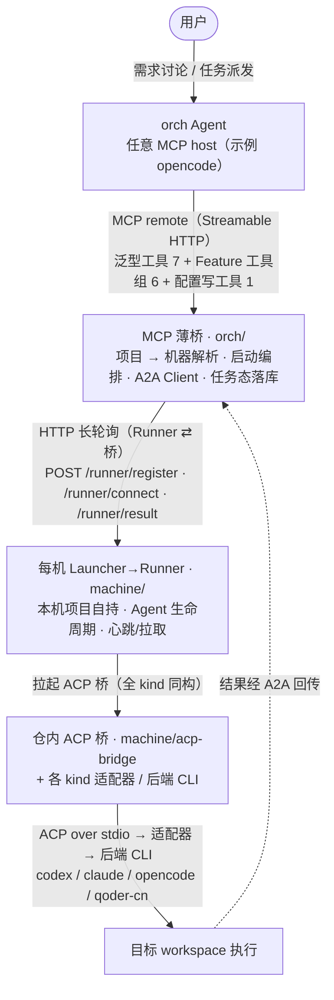

# a2a-coding

> 基于 A2A 的分布式 Code Agent 协作：以 orch Agent 为统一入口，按「项目」组织 Code Agent，三端均支持（OpenCode / Codex / Claude Code），让需求讨论留在 orch、执行交给各项目自己的 Agent。（Runner ⇄ Bridge 线协议 2.3）

<!-- badges 待补充：仓库暂无 LICENSE 文件、无 CI 状态、无发布版本，可在此补充 License / Build Status / Version 徽章 -->

## 目录

- [简介](#简介)
- [功能特性](#功能特性)
- [演示 / 截图](#演示--截图)
- [技术栈](#技术栈)
- [快速开始](#快速开始)
  - [环境要求](#环境要求)
  - [安装](#安装)
  - [配置](#配置)
  - [运行](#运行)
- [使用示例](#使用示例)
- [作为 orch 宿主快速开始](#作为-orch-宿主快速开始)
- [把流程规范引入你的项目](#把流程规范引入你的项目)
- [配置说明](#配置说明)
- [API 文档](#api-文档)
- [目录结构](#目录结构)
- [开发](#开发)
- [测试](#测试)
- [构建与部署](#构建与部署)
- [常见问题](#常见问题)
- [贡献指南](#贡献指南)
- [许可证](#许可证)
- [致谢](#致谢)

## 简介

a2a-coding 让开发协作时 orch 只管派发任务；目标项目的执行 Agent 按需拉起，在对应 workspace 实际执行，结果回传 orch，用完退出但会话可继承。架构不依赖「必须跨机器」：同一台机器上跑 orch 与 Launcher 同样成立，链路只是简化为本机调用。

架构为三段式：orch 侧的 MCP 薄桥只做「项目 → 机器」解析与转发；每台执行机器常驻一个 Launcher（Runner），负责本机项目 Agent 的生命周期；Launcher 按 `agentKind` 拉起**仓内 ACP 桥**（`machine/acp-bridge`）—— 四条 kind（opencode / codex / claude / qoder-cn）执行层**同构**：桥以 ACP over stdio 驱动后端（codex / claude 经第三方 ACP 适配器，opencode / qoder-cn 直连其 ACP 入口）。跨机通信走 A2A，orch 的工具面走 MCP，全程无中心注册。三端均已完成真实模型端到端验证（拉起 → 派发 → 执行 → 回传，退出后携带同一 `contextId` 续接）。



- **配置管授权、DB 管在线态（v0.7.0）**：项目→机器映射来自每机静态配置；桥侧建轻量注册视图（runners/runner_projects 运行态投影），机器经 Runner 出站注册+心跳维持在线态。
- **按需幂等（pull 反转）**：orch 入站调度不变；执行面由 Runner 长轮询领取任务后本地 `ensure`，幂等收据经 claim CAS 去重。
- 用完退出：项目 Agent 空闲超时自动回收，会话靠 `contextId` 续接。

### 部署形态

「机器」是一个逻辑单位，可以是远端主机，也可以是本机；「项目 → 机器」的映射全部来自静态配置，因此同一套架构天然支持以下形态：

| 形态 | 说明 |
|------|------|
| 跨机跨环境 | orch 在一台机器上讨论，执行 Agent 在另一台机器上运行（例：Windows 的 orch + Mac 上的执行 Agent），跨机通信走 A2A。 |
| 同机多项目 | 同一台机器上一份 Launcher 管理多个项目，各项目独立 `workspace` 与 A2A 端口，前后端 / 多项目并行协作。 |
| 多角色 | 同一项目或不同项目分别绑定开发 / 审查 / 测试 Agent，按任务选择派发目标。 |

同机即「机器 = 本机」：项目照样解析到本机的 Launcher，只是链路从跨机 A2A 简化为本机调用，架构与跨机完全一致。反向代理带来的网络可达性、认证与安全边界等额外注意事项只在跨机时出现，详见「常见问题」。

相关文档：

- [PROTOCOL.md](PROTOCOL.md)：Bridge ⇄ Launcher 线协议契约（端点 / 字段、版本规则、握手语义、可支持对端版本维护流程、演进记录表）。
- [CHANGELOG.md](CHANGELOG.md)：版本变更记录。

## 功能特性

- ✅ **四 kind 执行 Agent（同构）**：Launcher 按 `agentKind` 统一拉起**仓内 ACP 桥**（`machine/acp-bridge`）—— codex / claude 由桥 spawn 第三方 ACP 适配器（`codex-acp` / `claude-agent-acp`）再驱动后端运行时，opencode / qoder-cn 由桥直连其 ACP 入口（`opencode acp` / `qodercn --acp`）。
- ✅ **静态分布，无中心注册**：项目到机器的映射来自配置，不做自注册、心跳、TTL 或服务发现。
- ✅ **Runner 反向注册（v0.7.0 pull）**：Launcher 升格 Runner——出站注册（携带 machineId + projects + capabilities + selfCheck + protocolVersion）→ 长轮询拉取任务/指令 → 本地 ensure 执行 → 结果回传（outbox + ack，可重放）；入站 `/projects`·`/ensure`·`/{id}/stop` 退役（404）。
- ✅ **按需幂等（pull 语义保持）**：命令族 dispatch/stop/cancel-task 均携 commandId；claim 用 CAS 幂等，控制面离线不清在飞任务（心跳失败只降注册态、不触发 stop）。
- ✅ **常驻桥接入（v0.7.1）**：桥以**常驻进程**运行（`orch/scripts/bridgectl.mjs` 启停），orch 经 MCP `type: "remote"`（stateless Streamable HTTP，默认 `http://127.0.0.1:8787/mcp`）连接；**stdio 形态已退役**（不再由 orch agent 作为子进程拉起）。
- ✅ **泛型 MCP 工具面**：orch 只经 `a2a_projects` / `a2a_call` / `a2a_task_status` / `a2a_tasks` / `a2a_cancel` / `a2a_events` / `a2a_wait` 通信，agent 增减无需重连或刷新工具面。其中 **`a2a_call` 的 `mode` 必填**（`"inquiry"` 只读询问 / `"execute"` 执行型派发，后者必带 `featureId`）—— **保证"执行必走引擎"**。
- ✅ **项目组与选择性连接（v0.6.0 · v0.8.6 扩为一桥多组）**：orch 侧可声明**静态项目组**（`orch/config/config.json` 的 `projectGroup` **组数组**，每项 `{ name, members[] }`，成员 = `machineId × projectId`；**键名沿用、形状由「单组对象」扩为数组**）。声明后 orch **只连「有成员的机器」、只用「列名成员的项目」** —— 未列成员的项目**不 ensure、不派发、不出现在 `a2a_projects`**；派发到非成员会**显式失败**（`project_not_a_member`，与「项目不存在」的 `project_not_found` 分开）。**一桥多组**：一座编排桥同时服务多个 orch agent，**连接身份 = url 路径首段**（`http://127.0.0.1:8787/<组名>/mcp`），带身份的连接只见本组（任务 / 事件 / Feature **谁建谁见**）；未配组 ⇒ `/mcp` 全量接纳（零破坏），**配了组 ⇒ 不带身份 = 403 `group_identity_required`**（fail-closed，不回退全量）。**组间互斥**：同一 `(machineId, projectId)` 只能属一组 ⇒ 配置期 fail-fast。⚠ **组不是鉴权边界**（`/mcp` 零鉴权，组名只收窄视野、不决定「谁能连」；3300 网页面是运维全量视图，不是身份面）。**machine 侧零改动、线协议不动、架构约束不变。**
- ✅ **Feature 编排**：把一个需求作为 Feature，经状态机 + Task DAG 调度器跨项目自动派发，中途可停下审批 / 澄清；**同 project 粒度串行**（同一时刻最多一个任务在写同一工作区）、跨 project 并行；**失败只冻结依赖闭包**（未派发的下游），不带病继续也不连坐其它 project。
- ✅ **会话映射持久化**：`contextId ↔ sessionId` 落 SQLite（`node:sqlite`），两侧进程重启均不丢。
- ✅ **任务态回传与兜底找回**：任务态与结果落库；丢失 `taskId` 句柄可用 `a2a_tasks` 找回。
- ✅ **最小权限**：项目 `risk` 档位（`read` / `write` / `full`）映射到各端权限 / 沙箱参数。
- ✅ **跨平台后台启停**：`launcherctl.mjs` 在 Windows / Linux / macOS 统一 start / stop / restart / status / logs。
- ✅ **线协议版本化握手**：桥首触一台机器先握手校验主版本，不兼容即拒绝派发并给出升级指引。
- ✅ **启动自检与空闲回收**：Launcher 启动时对全部项目跑真实最小任务自检；项目 Agent 空闲超时自动回收。
- ✅ **失败上收与重派（v0.6.1）**：任务失败**不判死整单、不自动重试** —— 引擎只冻结其依赖闭包下游（`blocked`），把还能干的干完；收敛（无可派发 && 无在飞）且有失败 ⇒ Feature 保持 `executing` 自然**静止**，发一条 **`feature.failure_report`** 事件（账单 = 失败节点 `text`/`taskId`/`contextId` + 冻结集），宿主经 **`a2a_feature_advance(..., retryTaskIds?)`** 裁量重派（重派失败节点 + 自动解冻其下游）。**配套同 project 串行 + 静止期禁 `ensure`**（不顶掉空闲回收窗口）。
- ✅ **孤儿进程回收（v0.4.1）**：Launcher 启动时**对账清理**进程账本里的无主孤儿 —— 这是唯一能修「孤儿占住 `a2aPort` ⇒ 新 Launcher 自检 `EADDRINUSE` ⇒ 服务起不来」的动作；另提供只读兜底 `npm run reap`（默认只列不杀，`--clean` 才清，红线：pidfile 存活一律禁清）。

- ✅ **只读数据面（HTTP API，orch 侧）**：orch 侧常驻桥可另起一个**只读 HTTP 服务**（默认仅常驻形态、仅 `owner`、绑 `127.0.0.1`、端口 **3300**），暴露 `/api/*`（项目成员含在线态 · Feature / Task 状态 · 事件流增量）；数据只读自桥的 SQLite 与 Launcher `GET /projects`，**不改线协议、不做第二编排入口**。**v0.9.3 起 3300 的 HTML 页面已退役**（原「两面板单页」下线、`GET /` 不再提供），**`/api/*` 数据面全保留**，主要消费方转为板（`board/`）。
- ✅ **板（`board/`，v0.9.0 起 · 可选）**：架在 orch agent 前面的 **Web 操作端**——人是唯一入口（选组织 / 提需求 / 触发一轮对话 / 点方案确认 / 排期），板为每个需求驱动一个编排 agent，人不直接使用 agent。形态 = 组织门户（`/`）+ 组织空间（`/org/<组织名>/…`：排期看板 · 需求池 · 需求详情 · 时间轴 · 依赖图 · Agent 视图）+ 组织与项目成员管理（写面经桥的 O1 受控写工具落 `projectGroup`）+ 板侧版本台账（`.data/versions.json`：未开始 / 进行中 / 已发版三态与已发版排期锁）。**板不写状态机迁移**——状态机的唯一写入口仍是引擎的 Feature 工具面；板只写登记字段（`version` 等）与自身台账。启停与配置见 [board/README.md](board/README.md)。

## 演示 / 截图

暂无。本项目以 CLI / MCP 与常驻服务为主，没有可视化界面，仓库暂未提供演示视频或截图。

## 技术栈

| 层 | 技术 |
|----|------|
| MCP 桥（orch 工具面） | Node.js + TypeScript，官方 `@a2a-js/sdk`（A2A Client）+ `@modelcontextprotocol/sdk` + zod |
| 每机启动器（Launcher） | Node.js + TypeScript + express，常驻各机，管理本机项目 Agent 生命周期 |
| 执行层（ACP 桥 + 适配器） | 仓内 ACP 桥 `machine/acp-bridge`（**四条 kind 同构**：v0.8.0 起 qoder-cn、v0.8.1 起 opencode、**v0.8.5 起 codex / claude**）+ 各 kind 适配器 / 后端（`codex-acp` / `claude-agent-acp` / `opencode acp` / `qodercn --acp`），按 `agentKind` 分派；仓外 A2A 包装器已于 v0.8.5 退役 |
| 会话 / 任务存储 | `node:sqlite`（SQLite，桥侧持久化 sessions + tasks + features） |
| 协议 | A2A（协议 1.0，跨 Agent 通信）；Bridge ⇄ Launcher 走 HTTP 线协议 |
| 运行时 | Node.js ≥ 22.5（使用内置 `node:sqlite`）、TypeScript、ESM |

## 快速开始

### 环境要求

- Node.js ≥ 22.5（会话 / 任务库用内置 `node:sqlite`）。
- **orch agent 与 `orch/`（MCP 桥）的连接**：**唯一形态 = 常驻桥 + MCP `type: "remote"`（stateless Streamable HTTP，默认 `http://127.0.0.1:8787/mcp`）**；stdio 形态已随 v0.7.1 退役，桥不再由 orch agent 作为子进程拉起。桥须经 `orch/scripts/bridgectl.mjs` 常驻启动（`cd orch && npm run bridge:start -- --no-wait`，再 `npm run bridge:status` 确认就绪，见[常驻部署形态](#常驻部署形态)）。连接不再要求桥与 orch agent 同机：桥可运行在任意可达主机（默认只绑 `127.0.0.1`，非 loopback 暴露须反代 + 鉴权）。执行机器（Launcher + 项目 Agent）可在本机或远端。
- 执行机器按项目 `agentKind` 准备对应的 CLI 与认证（Launcher 从自身进程环境继承）：
  - `opencode`（v0.8.1 起走 ACP 桥）：PATH 上有 `opencode` CLI；Launcher 拉起**仓内 ACP 桥**（`machine/acp-bridge`），ACP 桥内部 spawn `opencode acp`（不再拉起 `opencode serve` 前置后端，该 sidecar 已随迁 ACP 退役）。`agentConfig.backendCmd` 为**可选覆盖**（v0.8.6 起缺省按四层链自动解析 `opencode-ai` 的 ACP 入口；显式填写时 Windows 下用 `opencode.exe` 绝对路径——npm 裸 PATH 只有 .cmd/.ps1 壳，ACP 桥无 shell 直调会 ENOENT）。模型写在该项目**平铺** `agentConfig.model`（v0.8.4 起由 `agentConfig.opencode.model` 迁入平铺，值形如 `providerID/modelID`，见下「per-project 模型」；段内遗留键随 v0.8.5 段退役，一律不生效）。
  - `qoder-cn`（v0.8.0 起走 ACP 桥）：`agentConfig.backendCmd` 为**可选覆盖**（v0.8.6 起自动解析：已知安装位置白名单 —— win `~/.qoder-cn/bin/qoderclicn/qoderclicn.exe` · mac `~/.local/bin/qoderclicn` —— 加 PATH 命令名 `qoderclicn`；装在非标准位置时显式填 `qoderclicn.exe` 绝对路径覆盖）；模型写在该项目**平铺** `agentConfig.model`（v0.8.4 起由 `agentConfig.qoder-cn.model` 迁入平铺，取值为 `machine/config/model-catalog.json` 里的 modelId，如 `qmodel_38max`；段内遗留键随 v0.8.5 段退役，一律不生效）。
  - `codex`（v0.8.5 起走 ACP 桥）：由第三方 **ACP 适配器 `codex-acp`** 承载（适配器自带 `@openai/codex` 运行时，**无需在 PATH 安装全局 `codex` CLI**；改 codex 版本 = 改适配器依赖版本）。`agentConfig.backendCmd` 为**可选覆盖**（v0.8.6 起缺省按四层链自动解析适配器入口；显式填写时指向其 `dist/index.js` 绝对路径 ⇒ 适配器自动以 node 拉起，npm 产的 `.cmd` / `.ps1` 壳在无 shell spawn 下会 `ENOENT`）。模型写在该项目**平铺** `agentConfig.model`（见 `machine/config/model-catalog.json` 的 codex 段）。认证 / 自定义网关沿用 codex 自身配置（`OPENAI_API_KEY`，或 `codex login` 生成的 `~/.codex/auth.json`）：网关经 `~/.codex/config.toml` 的 `[model_providers.*]` 配置，`base_url` 须为 OpenAI 兼容地址，注意 codex 会在其后拼接 `/responses`（`wire_api = "responses"`），网关地址需含版本段（如 `https://…/v1`）。
  - `claude`（v0.8.5 起走 ACP 桥）：由第三方 **ACP 适配器 `claude-agent-acp`** 承载（适配器自带 Claude Code 运行时，**无需在 PATH 安装全局 `claude` CLI**）。`agentConfig.backendCmd` 为**可选覆盖**（v0.8.6 起缺省按四层链自动解析适配器入口；显式填写时用其 `dist/index.js` 绝对路径 ⇒ 适配器自动以 node 拉起）。默认**加载用户级配置**（读取 `~/.claude/settings.json` 的模型 / 网关 / 认证 `env`），交互式 Claude Code 已配好的用户开箱即用；模型写在该项目**平铺** `agentConfig.model`（`default` / `opus` / `fable` / `sonnet` / `haiku`，见 `machine/config/model-catalog.json` 的 claude 段）。
- `agentConfig.<kind>` 段（`agentConfig.codex` / `agentConfig.claude` 等）已于 v0.8.5 **整体退役** —— 旧段内键（含 `codex.skipGitRepoCheck`、`claude.settingSources`、段内 `model`）不再被读取；codex 项目在**非 git workspace** 下的可用性列为 v0.8.5 待复核项（见改造文档 §4.2-16）。
- orch（**任意支持 MCP `type: "remote"`（Streamable HTTP）的 agent**，如 opencode / Claude Code / Codex / Cursor）与执行机器的 CLI 都已配好模型 provider，否则无法调用模型。
- Windows / macOS 均可，单元内的 CLI 参数已做跨平台处理。

### 安装

先克隆仓库，再分别安装两个部署单元（`orch/` 与 `machine/` 各自自包含，各自 `npm install`）：

```bash
git clone <仓库地址>
cd a2a-coding

# 执行机器：Launcher
cd machine
npm install          # 安装依赖（v0.8.5 起无 postinstall / 会话落盘补丁）

# orch 机器：MCP 桥
cd ../orch
npm install
npm run build        # 产出 dist/bridge/index.js
```

### 配置

两个单元各有一份 `config/config.json`，实际配置不入库，首次部署从 `config/config.json.default` 复制并填入真实值：

- 执行机器：`machine/config/config.json`，声明 `machineId`、`launcher` 与 `projects[]`。
- orch 机器：`orch/config/config.json`，声明 `machines[]`（每项 `machineId` + `launcherUrl`）。

字段说明见 [配置说明](#配置说明) 与各单元 `config/config.json.default`。

桥须先以常驻进程启动（v0.7.1 起 stdio 形态已退役，此为该桥唯一接入形态；桥进程的环境变量见[桥的环境变量](#桥的环境变量)）：

```bash
cd orch
npm run bridge:start -- --no-wait   # 发起即返（exit 0 = 已发起，≠ 就绪）
npm run bridge:status               # 确认就绪（pid / host:port / health / role / startedAt）
```

再把 `mcp.a2a` 配进 orch agent。把下面这段加入 orch 宿主的 MCP 配置后重启 orch；下例为 opencode 的 `opencode.json`，**任何支持 MCP `type: "remote"`（Streamable HTTP）的 agent**（Claude Code、Codex、Cursor 等）同理，仅配置位置与格式不同：

```json
{
  "$schema": "https://opencode.ai/config.json",
  "mcp": {
    "a2a": {
      "type": "remote",
      "url": "http://127.0.0.1:8787/mcp",
      "enabled": true
    }
  }
}
```

`url` 默认即 `http://127.0.0.1:8787/mcp`（= `transport.http` 的 `host:port/path`，见下）；桥可运行在任意可达主机，改 `url` 指向实际地址即可（默认只绑 loopback，跨机暴露须反向代理 + 鉴权）。若 orch 不是 opencode，按该 agent 登记 remote MCP server / Streamable HTTP 端点的方式配置同一 URL 即可，桥本身不绑定任何宿主。**桥配了项目组（`projectGroup` 组数组）时，url 把组名写在路径首段** —— `http://127.0.0.1:8787/<组名>/mcp`（身份由 url 决定、一座桥可同时接多个 orch agent；未配组仍写 `/mcp` 即全量接纳，详见下「配置说明」`projectGroup` 行）。仓库内 `orch/opencode.json.example` 与根 `opencode.json.example` 都是把 `mcp.a2a` 配进 orch 的样例。

> **唯一接入形态（v0.7.1）**：**常驻桥 + MCP `type: "remote"`**（stateless Streamable HTTP，默认绑 `127.0.0.1`、端口 `8787`、路由 `/mcp`）。stdio 形态已退役：桥不再作为 orch agent 的子进程拉起，`transport.mode = "stdio"` 会被拒绝（fail-fast）。常驻部署见[常驻部署形态](#常驻部署形态)。

### 运行

执行机器以后台常驻方式启动 Launcher（跨平台，日志写入 `machine/.a2a/logs/launcher.log`）：

```bash
cd machine
npm run start -- --no-wait   # 后台启动：发起即返（exit 0 = 已发起，≠ 业务就绪）
npm run status               # 查看 pid / host:port / health / startedAt（确认就绪）
```

> **就绪语义与全部选项以 [machine/README.md](machine/README.md) 为唯一锚点**：缺省 `start` 只等「服务可答」，**`exit 0` ≠ 业务就绪**；需要业务就绪用 `npm run start -- --wait-ready`。⚠ npm 会吞掉裸 `--no-*`，透传必须写 `--`。

启动后，Launcher 会按配置监听端口并暴露本机项目；orch 侧即可通过 MCP 工具派发任务。首次落地时 Launcher 默认对全部项目跑一遍启动自检，自检通过才放行业务路由（详见 [构建与部署](#构建与部署)）。

前台调试可用 `npm run launcher`（先 `tsc` 构建，再运行 `dist/launcher/index.js`）；完整的启停 / 日志命令见 [构建与部署](#构建与部署)。

## 使用示例

工具面为「**泛型工具 7 + Feature 工具组 6 + 配置写工具 1**」，在 orch 里直接调用：

```text
a2a_projects()
a2a_call(project="machine", message="列出当前目录的顶层文件", mode="inquiry")
a2a_call(project="machine", message="把刚才的结果按类型分组", contextId="<上一轮返回的 contextId>", mode="inquiry")
```

`a2a_call` 省略 `contextId` 时自动新建并在返回中给出；续接同一上下文时把它带回来即可。**`mode` 必填**：只读询问用 `"inquiry"`；要真正派发实现任务则用 `"execute"` 并**必须**带 `featureId`（见下）。

Feature 编排（把一个需求作为 Feature 推进）：

```text
# 1) 提需求即入板：建 Feature（初态即 waiting_approval，登记字段初值恒定 stage=需求分析 + approval=未发起）
a2a_feature_create(title="给登录页加记住我", requirement="…", version="0.10.5")
# 2) 用户确认方案后放行：approve = 记录已发生的用户确认（一对一，不可预领/不可补领）
#    目标态按父链分流：无父（主轨）→ version_planning（定版工序）；有父（增补/承接轨）→ decomposing
a2a_feature_approve(featureId="<id>")
#    ⚠️ 不能再用 a2a_feature_advance(to="executing") 绕门 —— 会被拒（feature_approval_required）
# 3) 定版工序内先建 Project Version、再写归属；归属非空才出得了格（空 ⇒ feature_attribution_required）
a2a_feature_advance(featureId="<id>", to="decomposing", projectVersions=[{projectId:"machine",version:"0.9.8"}])
# 4) 拆任务格内登记 DAG 节点（可挂载态 = executing / decomposing；waiting_approval 已摘出）
a2a_call(project="machine", message="…", mode="execute", featureId="<id>")
# 5) 登记完毕 ⇒ advance 进 executing，桥内 Task DAG 调度器按 dependencies 拓扑派发
#    （同 project 串行、跨 project 并行；decomposing 内登记的节点不占机器资源 —— 派发门只看 executing）
a2a_feature_advance(featureId="<id>", to="executing")
# 4) 任务需澄清时 Feature 停 needs_input，补齐答案续推（局部澄清；整案回炉需 cancel + 新建）
a2a_feature_advance(featureId="<id>", to="executing", answer="…")
# 5) 任务失败时 Feature 停在 executing 静止（a2a_events 收 feature.failure_report 账单一次），
#    宿主裁量后重派失败节点（同时自动解冻其被冻下游；同 contextId 续接）
a2a_feature_advance(featureId="<id>", retryTaskIds=["<失败节点 taskId>"])
```

**主链为 8 态**：`waiting_approval → version_planning → decomposing → executing → integrating → testing → reviewing → completed`（`version_planning` = `approve` 后的定版工序、`decomposing` = 拆任务与 DAG 登记；Step 0/1 由宿主驱动、**引擎不参与**）。

调度器为**代码组件**，LLM 不参与等待 / 轮询。

## 作为 orch 宿主快速开始

本仓本身就是一套可直接使用的「完整 orch 宿主包」：`orch/` 桥 + `machine/` Launcher + `flow/` 流程规范 + 配置模板。交付 A 的接入步骤：

1. clone 本仓，分别安装并构建两个单元：

   ```bash
   cd machine && npm install
   cd ../orch && npm install && npm run build
   ```

2. 起 Launcher（执行机器，一律经 `machine/scripts/launcherctl.mjs`）：

   ```bash
   cd machine && npm run start
   ```

3. 填两份配置：`machine/config/config.json` 的 `projects[]`（本机项目），`orch/config/config.json` 的 `machines[]`（机器 → Launcher 地址）。字段说明见[配置说明](#配置说明)。

4. 启动桥与宿主：先 `cd orch && npm run bridge:start -- --no-wait` 并 `npm run bridge:status` 确认就绪（桥为常驻进程，stdio 形态已退役）；宿主（如 opencode）按 [opencode.json.example](opencode.json.example) 建 `opencode.json`，经 `instructions` 加载 `flow/spec/`，并以 remote 形态注册 `mcp.a2a`（默认 `http://127.0.0.1:8787/mcp`）。

5. 验证：在宿主里调用 `a2a_projects()`，能列出项目即接入成功。

完整说明见 [flow/README.md](flow/README.md)。

## 把流程规范引入你的项目

已有自己的宿主配置与项目文档（`CLAUDE.md` / `AGENTS.md`）时，用 `flow/install/install.mjs` 把需求流程规范**旁路**引入既有项目。交付 B 的接入步骤：

```bash
node flow/install/install.mjs --target <项目根>
```

引入是旁路、幂等、可还原的：**不改动目标项目既有的 `CLAUDE.md` / `AGENTS.md`**，只在宿主配置里新增 `mcp.a2a` 并追加 `flow/spec/` 的 `instructions`。撤销：

```bash
node flow/install/uninstall.mjs --target <项目根>
```

细节见 [flow/README.md](flow/README.md)。

## 配置说明

### machine：`machine/config/config.json`

每台机器自维护本机项目（实际配置 `config/config.json` 不入库，首次部署从 `config/config.json.default` 复制并填入本机真实值）。

| 字段 | 说明 | 默认值 | 必填 |
|------|------|--------|------|
| `machineId` | 机器标识，需与 orch 机器清单一致 | - | 是 |
| `launcher.port` | Launcher 监听端口 | - | 是 |
| `launcher.idleStopMs` | 空闲回收时长（毫秒），项目 Agent 超过该时长没有 `ensure` 调用就自动 `stop`；`0` 或负值表示禁用。**（v0.6.0 起）若该机项目被列为 orch 项目组成员，推荐保持 `> 0`**：成员被移出后 orch 不再 `ensure`，靠空闲回收自动收回已拉起的 agent；设为 `0`（禁用回收）时该 agent **可能长期驻留**，需人工 `POST {launcherUrl}/projects/{projectId}/stop`（注意 `launcherctl.mjs` **不含**单项目 stop）。启动日志可直接辨识：`[launcher] idleStopMs=disabled` | `300000` | 否 |
| `launcher.startupCheck` | 启动自检开关，`false` 跳过自检直接进入服务 | `true` | 否 |
| `launcher.startupCheckTimeoutMs` | 每个项目自检的总超时（毫秒） | `120000` | 否 |
| `launcher.startupCheckPrompt` | 自检 prompt | `Reply with exactly: OK` | 否 |
| `launcher.listenHost` | Launcher 绑定地址；缺省不设置 = 绑定全部网卡。启用 `shutdownEndpoint` 时建议设为 `127.0.0.1` | 不设置 | 否 |
| `launcher.shutdownEndpoint` | `true` 时注册 `POST /shutdown`（仅接受 loopback 来源）。反代转发后源地址为 loopback，**Caddy / 反向代理必须 deny `/shutdown`** | `false` | 否 |
| `launcher.shutdownToken` | `POST /shutdown` 的 Bearer 令牌（`Authorization: Bearer <token>`） | 不校验 | 否 |
| `projects[]` | 本机项目列表 | - | 是 |
| `projects[].projectId` | 项目标识，全局唯一 | - | 是 |
| `projects[].workspace` | 执行目录 | - | 是 |
| `projects[].agentKind` | `opencode` / `codex` / `claude` / `qoder-cn` | - | 是 |
| `projects[].a2aPort` | 该项目 A2A Server 监听端口 | - | 是 |
| `projects[].risk` | 项目风险档位，`read` / `write` / `full`，由**适配器**映射为 **ACP 会话模式**（经 ACP 桥 `--mode` 下发），决定可读 / 可写 / 全权限；映射表见下「`risk` 到各端权限 / 模式的映射」 | `write` | 否 |
| `projects[].agentConfig` | 项目级运行参数（**v0.8.5 起全 kind 统一平铺，无 `agentConfig.<kind>` 段**）：平铺键由 Launcher / ACP 桥自消费（如 `model` / `backendCmd` / `systemPrompt` / `systemPromptMode`），旧段内键（`events` / `timeouts` / `agentCard` / `codex.*` / `claude.*` / 段内 `model`）随段退役。Launcher **不再生成** `agents/<agentKind>.<projectId>.json`、**不再传** `--config-file` / `--config-segment`；自定义注入改走「平铺键 + 桥 flag」。键位明细见 `machine/README.md` | - | 否 |
| `projects[].agentConfig.model` | **per-project 模型名（v0.8.5 起四条 kind 统一平铺键）**：值 = 后端自己的 modelId（opencode 形如 `providerID/modelID`；qoder-cn / codex / claude 取 `machine/config/model-catalog.json` 的 key）。适配器原样透传 `--model` ⇒ ACP 桥在每次会话建立后（`session/new` / `load` / `resume` 三路）发一次 ACP `session/set_config_option { configId: "model" }`（set 是 per-session，恢复路径不假设后端保持模型）。值**不校验、不映射**（`-m` 吃显示名、协议面吃 modelId，两家取值口径不同 ⇒ 统一只走协议面，后端 argv 不再拼 `-m`）；**不配 / 空串 ⇒ ACP 桥完全不发该请求**，走后端自身默认。配错（无效 modelId）⇒ **任务明确失败**（fail-fast，不静默回落）。**v0.8.4 起由 `agentConfig.<kind>.model` 迁入平铺、v0.8.5 收口至全 kind**：段内 `model`（含 codex / claude）**一律不生效**（段已退役，Launcher 不再读取） | - | 否 |

`risk` 到各端权限 / 模式的映射（**v0.8.5 起四条 kind 同构**：`risk` 由**适配器**映射为 ACP **会话模式**、经 ACP 桥 `--mode` 下发；**映射表唯一落点 = 适配器**，桥对 kind 无知）。`write` 为默认：

| risk | codex（`--mode`） | claude（`--mode`） |
|------|------|------|
| `read` | `read-only` + `--collaboration-mode plan` | `plan` |
| `write`（默认） | `agent` | `acceptEdits` |
| `full` | `agent-full-access` | `bypassPermissions` |

> **codex `read` 档 = 可读、不可写（已由决定性组合探针验证）**：`mode=read-only` + `collaboration_mode=plan` + 客户端全拒 + 带写意图 ⇒ **文件不落盘、只输出计划**。两点须注意：① 终态是 **`end_turn`**（后端把拒绝释为「保持 plan 模式」，模型只给出计划），**不是** `cancelled`；② 因此上层**不得把「只出计划」误当成功**（§4.2-17，待验）。完整组合探针结论见改造文档 §4.2-4 / §6.1。
> **claude `full` 档**：`bypassPermissions` 经桥 `--session-meta-json` 下发 `session/new` 的 `_meta`（new / load / resume 三路统一携带，否则经 `load` / `resume` 的会话会静默降级）；旧段键 `claude.dangerouslyAllowBypassPermissions` 随段退役。
> **四 kind 执行层同构**：由**仓内自持 ACP 桥** `machine/acp-bridge/` 承担 A2A 服务面（桥绑定项目 `a2aPort`，以 ACP over stdio 驱动 `backendCmd`）：codex / claude 的 `backendCmd` = 第三方 ACP 适配器（`codex-acp` / `claude-agent-acp`），opencode / qoder-cn = CLI 自带 ACP 入口（`opencode acp` / `qodercn --acp`）。`risk` 经桥 `--risk <read|write|full>` 透传（同时决定 ACP 权限应答策略）。opencode 认证沿用 `opencode` 自身配置；qoder-cn 优先文件凭据 `~/.qoder-cn/.auth`，备选 env `QODERCN_PERSONAL_ACCESS_TOKEN`（经 Launcher 进程环境透传）；codex / claude 认证沿用各自 CLI 配置（`~/.codex/auth.json` / `~/.claude/settings.json`）。示例见 `machine/config/config.json.default`。

样例：

```json
{
  "machineId": "win-dev",
  "launcher": { "port": 3100, "idleStopMs": 300000 },
  "projects": [
    {
      "projectId": "machine",
      "workspace": "G:/code/a2a-coding/machine",
      "agentKind": "opencode",
      "a2aPort": 3010,
      "agentConfig": {
        "events": { "enabled": false }
      }
    }
  ]
}
```

环境变量 `MACHINE_CONFIG` 可指定其他配置文件；缺省为 `config/config.json`（模板 `config/config.json.default`）。

### orch：`orch/config/config.json`

orch 只持有「有哪些机器、Launcher 地址」，项目明细由各机自持（实际配置 `config/config.json` 不入库，首次部署从 `config/config.json.default` 复制并填入真实机器地址）。字段为 `machines[]`（每项含 `machineId` + `launcherUrl`）与可选的 `projectGroup`（项目组数组，见下「一桥多组示例」）、`transport`（桥接入面，见[常驻部署形态](#常驻部署形态)）、`web`。

| 字段 | 说明 | 默认值 | 必填 |
|------|------|--------|------|
| `machines[].machineId` | 机器标识，需与本机 Launcher 配置一致 | - | 是 |
| `machines[].launcherUrl` | 该机 Launcher 地址（如 `http://localhost:3100`） | - | 是 |
| `projectGroup` | **v0.6.0 · v0.8.6 一桥多组**：静态「项目组」—— **组数组** `[{ name, members: [{ machineId, projectId }] }]`（**键名沿用 `projectGroup`、不叫 `projectGroups`**；`name` = 组名，必填，字符集 `[A-Za-z0-9_-]+`，且不得与保留 URL 首段 `health`/`shutdown`/`runner` 冲突）。声明后 orch **只连有成员的机器、只用列名成员的项目**（未列成员不 ensure / 不派发 / 不展示）；每组 `members` **不得为空数组**；`machineId` 必须存在于 `machines[]`；**组间互斥**——同一 `(machineId, projectId)` 只能属一个组，出现在两组 ⇒ **配置期 fail-fast**（桥拒绝启动）。**连接身份 = url 路径首段**：宿主 MCP url 写 `http://<host>:8787/<组名>/mcp`；**配了组后不带身份的 `/mcp` 被 403 `group_identity_required` 拒绝**（fail-closed，不回退全量）。⚠ **组不是鉴权边界**（`/mcp` 零鉴权，组名只决定视野收窄、不决定谁能连；3300 只读工作台是**运维全量视图**，不作为身份面）。**段缺省 = 未配任何组 = 全量接纳**（与旧版行为一致、零破坏） | 不设置（全量接纳） | 否 |
| `transport` | 桥接入面配置（**可选**）；v0.7.1 起桥只有常驻 HTTP 形态 | 不设置（按 http 缺省启动） | 否 |
| `transport.mode` | 只允许 `"http"`；显式 `"stdio"` 会被拒绝（fail-fast，stdio 形态已退役） | `"http"` | 否 |
| `transport.http` | 常驻 HTTP 监听配置 `{ host, port, path }` | `{ "host": "127.0.0.1", "port": 8787, "path": "/mcp" }` | 否 |
| `web.enabled` | 只读工作台开关（页面 + `/api/*`）；**仅常驻（http）形态 + 仅 `owner` 实例**真正 bind | `true` | 否 |
| `web.host` | 只读工作台绑定地址（建议 loopback） | `127.0.0.1` | 否 |
| `web.port` | 只读工作台监听端口 | `3300` | 否 |
| `web.allowStdio` | 旧字段：stdio 形态（v0.7.1 已退役）下是否也开工作台；现无实际作用，保留仅为旧配置兼容 | `false` | 否 |

```json
{
  "machines": [
    { "machineId": "win-dev", "launcherUrl": "http://localhost:3100" }
  ],
  "web": { "enabled": true, "host": "127.0.0.1", "port": 3300, "allowStdio": false }
}
```

> `web`（只读工作台）：缺省**仅常驻（`transport.mode=http`）形态 + 仅 `owner` 实例**提供页面（`allowStdio` 为旧字段，随 stdio 形态退役、现无实际作用）；端口被占 ⇒ **warn 降级、不伤 MCP**；只读、仅 loopback、**无鉴权** ⇒ 暴露到本机之外须先有 v0.7.0 的跨机鉴权。`/api/events` **直连 `listEvents`**，不会推移宿主收件箱的读游标。

环境变量 `MACHINES_CONFIG` 可指定其他清单文件；缺省为 `config/config.json`（模板 `config/config.json.default`）。

### 同机多项目示例

同一台机器上跑两个项目时，只需在**一份** machine 配置里多写几个 `projects[]`，各自用不同 `workspace` 与 `a2aPort`：

`machine/config/config.json`：

```json
{
  "machineId": "local",
  "launcher": { "port": 3100, "idleStopMs": 300000 },
  "projects": [
    { "projectId": "frontend", "workspace": "/abs/path/to/frontend", "agentKind": "opencode", "a2aPort": 3010 },
    { "projectId": "backend",  "workspace": "/abs/path/to/backend",  "agentKind": "opencode", "a2aPort": 3011 }
  ]
}
```

`orch/config/config.json`（同机：只需一条机器项，指向本机 Launcher）：

```json
{ "machines": [ { "machineId": "local", "launcherUrl": "http://localhost:3100" } ] }
```

orch 用 `project`（如 `frontend` / `backend`）派发到对应项目。

### 一桥多组示例

一座编排桥可同时服务多个 orch agent（多组）：`projectGroup` 写成**组数组**，宿主侧 MCP url 把**组名写在路径首段**（身份由连接 url 决定，没有第二种通道 —— 不读 header、不复用 Runner token）：

`orch/config/config.json`（多组 + 双宿主接入）：

```json
{
  "machines": [
    { "machineId": "win-dev", "launcherUrl": "http://localhost:3100" }
  ],
  "projectGroup": [
    { "name": "frontend", "members": [ { "machineId": "win-dev", "projectId": "web" } ] },
    { "name": "backend",  "members": [ { "machineId": "win-dev", "projectId": "api" } ] }
  ]
}
```

- 宿主 A 的 `mcp.a2a.url` = `http://127.0.0.1:8787/frontend/mcp` ⇒ 只见 `frontend` 组；宿主 B = `http://127.0.0.1:8787/backend/mcp` ⇒ 只见 `backend` 组（任务列表 / 事件收件箱 / Feature 均按身份收窄，Feature **谁建谁见**）。
- **配了组后**，不带身份的 `http://127.0.0.1:8787/mcp` 被 **403 `group_identity_required`** 拒绝（fail-closed，绝不回退全量接纳）；**未配任何组**时仍只有 `/mcp` 一个入口、全量接纳（旧部署零改动）。
- **组间互斥**：同一 `(machineId, projectId)` 出现在两个组 ⇒ **配置期 fail-fast**（桥拒绝启动）。
- ⚠ **组不是鉴权边界**：组名只决定「视野收窄到哪」，不决定「谁能连」—— 任何能访问该端口的进程写上组名即取得该组视野；真正的访问控制归「跨机鉴权 / 反向代理」待办。3300 只读工作台是**运维全量视图，不是身份面**。

### 桥的环境变量

| 变量 | 说明 | 默认值 | 必填 |
|------|------|--------|------|
| `MACHINES_CONFIG` | orch 机器清单文件路径 | `orch/config/config.json` | 否 |
| `SESSION_DB` | 会话 / 任务库 SQLite 路径 | `orch/data/sessions.sqlite` | 否 |
| `SYNC_BUDGET_MS` | `a2a_call` 同步等待预算（毫秒），超过即返回 `working + taskId` 转后台看护；**必须小于 orch agent 的 MCP 客户端请求超时**（`@modelcontextprotocol/sdk` 默认 60s，超时抛 -32001） | `30000` | 否 |

### Launcher 的环境变量

| 变量 | 说明 | 默认值 | 必填 |
|------|------|--------|------|
| `MACHINE_CONFIG` | machine 项目配置文件路径 | `machine/config/config.json` | 否 |

## API 文档

### Launcher HTTP 接口

Launcher 按 `machine/config/config.json` 监听（模板见 `machine/config/config.json.default`），暴露以下接口。同机部署时 orch 的 `launcherUrl` 指向 `http://localhost:<port>` 即可。

| 接口 | 作用 |
|------|------|
| `GET  /health` | 健康检查（自报线协议版本 `protocolVersion`） |
| `GET  /projects` | 本机项目清单 + 运行态 |
| `POST /projects/{projectId}/ensure` | 幂等启动，返回 A2A 端点 |
| `POST /projects/{projectId}/stop` | 停止项目 Agent |
| `POST /shutdown` | 优雅停止 Launcher（**可选**，`launcher.shutdownEndpoint=true` 时注册；仅接受 loopback 来源） |

Bridge ⇄ Launcher 的线协议以仓库根 [PROTOCOL.md](PROTOCOL.md) 为单一事实源（端点 / 字段、版本规则、握手语义、演进记录表）。

### 只读数据面 HTTP 接口（orch 侧，可选）

| 接口 | 作用 |
|------|------|
| `GET /api/projects` | 项目成员（machine × project + 在线态 + `observedAt`；**字段白名单**，不含 `workspace` / `agentConfig`） |
| `GET /api/features` | Feature 列表与状态 |
| `GET /api/tasks` | 任务列表（含耗时 = `finished_at - started_at`，任一端为 `NULL` 则不显示耗时） |
| `GET /api/events?since=` | 事件流增量（**不影响宿主收件箱游标**） |

默认仅常驻（`transport.mode=http`）形态、仅 `owner` 实例、绑 `127.0.0.1`、端口 `3300`；**只读**，不改线协议、**不是第二编排入口**（审批 / 澄清 / cancel 等操作端留后续版本）。**v0.9.3 起 HTML 页面退役**：原 `GET /` 单页工作台（两面板）已下线，仅保留上表的 `/api/*` 数据面（消费方 = 板 `board/`）。

### MCP 工具面

#### 泛型工具（7 个）

- `a2a_projects()`：列出**项目组成员**（未配置 `projectGroup` 时列出全部），含运行态与 A2A 端点。多组时**可见集由连接身份（url 路径首段 `/<组名>/mcp`）决定**，带身份的连接只列本组（详见「配置说明 · 一桥多组示例」）。出参含 `group`（**恒存在**）：`{ name: string | null, selective: boolean, memberMachines: string[] }` —— `memberMachines` = **配置声明的成员机器集合**（**非**运行时在线集合）；`selective: false` = 未配置项目组（全量接纳）。**无成员的机器整条不出现（含其 `error` 条目）。**
- `a2a_call(project, message, mode, contextId?, wait?, featureId?, dependencies?, inputs?)`：解析项目到机器，幂等 ensure。**`mode` 必填**：`"inquiry"` = 只读询问/核实（**不得带 `featureId`**）⇒ 立即派发；`"execute"` = 执行型派发（**必带 `featureId`**）⇒ 登记 Feature 队列节点，由调度器派发。默认半异步：≤30s 完成直接返回文本结果与 artifacts，更长返回 `working + taskId` 并用 `a2a_task_status` 轮询；`wait=false` 时永远立即返回 `working + taskId + contextId`（不进入同步轮询，后台看护照常落库）。
- `a2a_task_status(taskId)`：查询任务态并回写本地任务存储。已终结任务（completed / failed / input-required）由桥本地存档直接作答（不唤醒远端 Agent）；未终结任务走远端实时查询。
- `a2a_tasks(project, [state], [limit])`：按项目列出本地任务记录（默认 `updatedAt` 倒序、默认 20 条、最多 100），每条含 `prompt` 片段 / state / text / contextId / updatedAt / stale。用于丢失 `taskId` 句柄后的兜底找回。
- `a2a_cancel(taskId)`：取消任务，并回写本地任务存储。
- `a2a_events(since?)`：读取事件收件箱增量（任务结算 / 阻塞、Feature 流转）。省略 `since` 则自进程读游标起；无变化时廉价空返回。
- `a2a_wait(timeoutMs?)`：长轮询等待新事件（推送优先唤醒 + 定时对账），最多 `timeoutMs`（内部上限低于同步预算）；超时无事件则 `timedOut=true`。

#### Feature 工具组（6 个）

把一个需求作为 Feature 编排：`a2a_feature_create` 建 Feature → orch 组织各项目分析、汇总方案 → 卡在 `waiting_approval` 停下 → 用户 `a2a_feature_approve` 放行（主轨落 `version_planning`、增补/承接轨直接落 `decomposing`）→ 定版工序写归属、拆任务格登记 DAG 节点，各由宿主 `advance` 出格（**归属非空是出格凭据**）→ 进 `executing` 后桥内 Task DAG 调度器（**同 project 串行、跨 project 并行**）按 `dependencies` 自动派发各项目任务并推进至完成；任务需澄清时 Feature 停 `needs_input`，`a2a_feature_advance(..., answer=…)` 续推；**任务失败时** Feature 保持 `executing` 静止（`a2a_events` 发一次 `feature.failure_report` 账单），宿主 `a2a_feature_advance(..., retryTaskIds=[…])` 重派并解冻。**`version_planning` / `decomposing` 两格内不派发任何节点、不挂 `needs_input`、不产失败账单**（工序会话是只读同步会话）。

- `a2a_feature_create(title, requirement?, version?, contextId?, parentFeatureId?)`：新建 Feature，**初态即 `waiting_approval`**（= 改造文档确认门停靠点，**引擎只做需求实现**），返回 `featureId`。`stage` / `approval` **自 v0.10.5 起不再是入参** —— 初值由引擎硬编码为 `需求分析` + `未发起`（口径见 `flow/spec/引擎映射.md` §3.5「初值恒定」）；`version` 仍是入参；`stage` / `version` / `approval` 都是**登记字段（观测面，不是状态机态）**；`parentFeatureId` 用于验收增补轨挂主需求。
- `a2a_feature_status(featureId?)`：查看 Feature 详情 / 列表（state + tasks 摘要，含 `failureKind` / `retryCount`；省略 `featureId` 列出全部）。
- `a2a_feature_trace(featureId)`：**只读**回答「这个 Feature 为什么还没完成」——逐非终态节点给 `waitReason` / `position` / `waitedSince` / `projectBusy` / `lane` / `readOccupants[]`。用于区分「在排队」与「真在跑」（**两个时钟不得相加**：orch 领取队列的等待 ≠ machine 本机闸内等待）。纯读，不落库、不触发调度。
- `a2a_feature_advance(featureId, to, note?, answer?, retryTaskIds?, stage?, version?, approval?, decisions?, contracts?)`：推进状态机主链（校验合法后继，非法流转被拒）；**`to="executing"` 在 `waiting_approval` 会被拒**（`feature_approval_required`，请用 `approve`）；`answer` 用于 `needs_input` 补齐后续推；**`retryTaskIds`（v0.6.1）用于失败重派**（仅静止失败场景：重派指定未处置 `failed` 节点并自动解冻其被冻下游；不传/非法/与 `answer` 同传 ⇒ 结构化错误拒绝且 Feature 态不变）；**`to` = 当前态 ∧ 仅带登记字段 = 只写登记、不动主链**（`stage` / `version` / `approval` / `decisions` 走这条；`decisions` 为**整值替换**语义 —— 补登记须重发全量，不是 append；且必须与某枚登记字段同单发出，单发 `decisions` 会被拒）。
- `a2a_feature_approve(featureId)`：**唯一准入**——目标态按父链分流（v0.10.5）：无父卡（主轨）`waiting_approval → version_planning`，有父卡（增补轨 / 承接轨）`waiting_approval → decomposing`（不重走定版工序 ⇒ 跳过该格）。语义 = **记录已发生的用户确认（一对一映射：不可预领、不可补领）**：宿主在收到用户确认后**立即**调用，**不是新增一次用户决策**；禁止在用户未确认方案前调用。
- `a2a_feature_cancel(featureId)`：任意非终态 → `cancelled`（**执行中途"方案整体回炉"只能走这条**：主链无回边）。

#### 配置写工具（1 个）

- `a2a_config_write_group(op, groupName, members?)`：**受控写** orch `config.json` 的 `projectGroup` 段——它是项目组台账的**唯一机器写手**。**单组操作指令五操作**：`group.add` / `group.update`（members 整集替换）/ `group.remove` / `group.member.add` / `group.member.remove`（增删成员各带 `members=[{machineId, projectId}]`；组在 config 的出现由成员条目派生，改名语义不做，挪成员 = `member.remove` + `member.add` 组合）。写路径 = 互斥内 read → mutate → **dry-run（同源校验，坏写不落盘）→ backup → tmp+rename 原子替换**，成功出参带 `backedUpTo`（写前备份路径）。**错误码闭集**：`config_write_dry_run_rejected` / `config_write_unknown_machine` / `config_write_group_not_found` / `config_write_duplicate_member` / `config_write_concurrent_modification` / `config_write_io_failed`。配置面写**不受调用方连接身份的组可见性限制**，写后**热生效**（桥 per-call 现读，无需重启）。⚠ 拒绝全文替换整个文档。

`a2a_call` 的 `mode` **对偶校验**：`mode="execute"` 必带 `featureId`（否则 `feature_required_for_execute`）；`mode="inquiry"` **不得**带 `featureId`（否则 `feature_not_allowed_for_inquiry`）—— 由桥侧强制，**保证"执行必走引擎"**。

#### 任务态

A2A 任务态统一使用 `working` / `completed` / `failed` / `input-required`；对外用 A2A `contextId`，对内映射 CLI `sessionId`。

## 目录结构

代码按部署单元组织，`orch/`、`machine/`、`board/` 各自是独立部署单元（各有自己的 `package.json` / `tsconfig.json` / `node_modules/` / `dist/` / `config/`，彼此不跨单元 import、只经 HTTP / MCP 面耦合）。`flow/` 是需求流程规范包（项目无关，不参与 `npm` 构建），宿主经 `instructions` 加载其 `spec/` 内核。单元之间只通过线协议耦合：线协议以仓库根 [PROTOCOL.md](PROTOCOL.md) 为单一事实源，类型两侧各自声明、由契约测试（`test-protocol-version`）锁定一致；修改协议时先改 PROTOCOL.md 再同步两侧实现。

```text
a2a-coding/
├─ orch/                          # 部署单元 1（orch 机器）：作为 orch 的 MCP server 运行
│  ├─ package.json                # @a2a-coding/orch：@a2a-js/sdk / @modelcontextprotocol/sdk / zod
│  ├─ tsconfig.json
│  ├─ config/config.json          # 机器清单（实际，git 忽略）
│  ├─ config/config.json.default  # 机器清单模板（入库）
│  ├─ opencode.json.example       # 样例：把 mcp.a2a 配进 orch 的 opencode
│  ├─ types.ts  config.ts  app-root.ts
│  ├─ bridge/index.ts             # MCP 薄桥：泛型 7 + Feature 工具组 6 + 配置写 1；派发主链 dispatchTask
│  ├─ bridge/register-tools.ts    # 工具注册：createServer(core) 工厂 + registerTools(server, core)
│  ├─ bridge/transports/{http,web}.ts  # 接入面：stateless Streamable HTTP（/mcp /health /shutdown）/ 只读数据面 HTTP（/api/*；页面 v0.9.3 退役）（stdio 已于 v0.7.1 退役）
│  ├─ bridge/config-write.ts      # O1 受控写：projectGroup 段五操作指令（dry-run + backup + 原子替换）
│  ├─ runtime/{lifecycle,core-lease}.ts  # 启停编排与排空 + core 租约（单调度权，role owner/follower）
│  ├─ scripts/bridgectl.mjs       # 桥启停脚本（start/stop/restart/status/logs）
│  ├─ tools/mcp-http-probe.mjs    # 独立 MCP HTTP 探测客户端
│  ├─ bridge/task-watcher.ts      # 任务后台看护（轮询 + 续约至终态落库；onSettled 供调度器接驳）
│  ├─ bridge/scheduler.ts         # 拓扑并行 Task DAG 调度器（失败传播 blocked / 启动恢复）
│  ├─ bridge/feature-tools.ts     # Feature 工具组 handler（create / status / trace / advance / approve / cancel）
│  ├─ feature/state-machine.ts    # Feature 状态机（8 主态 + 异常态；纯函数，非法流转 fail-fast）
│  ├─ session/store.ts            # 会话/任务库（node:sqlite；sessions + tasks + features + artifacts + events）
│  └─ data/                       # 运行态：sessions.sqlite（git 忽略）
├─ machine/                       # 部署单元 2（每台执行机器）：每机常驻
│  ├─ package.json                # @a2a-coding/machine：express（四条 kind 均走仓内 acp-bridge；无仓外包装器依赖，适配器由后端侧自行安装）
│  ├─ tsconfig.json
│  ├─ config/config.json          # 本机项目配置（实际，git 忽略）
│  ├─ config/config.json.default  # 本机项目配置模板（入库）
│  ├─ types.ts  config.ts
│  ├─ launcher/{index,server,manager,ports,process,agent-config,self-check,config-snapshot,agents-prune,app-root}.ts
│  ├─ adapters/{index,types,json,opencode,codex,claude}.ts
│  ├─ acp-bridge/                 # 仓内 ACP 桥（A2A 服务面 + ACP over stdio client；四条 kind 同构）
│  ├─ scripts/                    # （wrapper 契约 / 会话落盘补丁三个验证脚本已随 v0.8.5 退役）
│  └─ .a2a/                       # 运行态：ACP 桥会话 .a2a/acp-sessions/（git 忽略）
├─ board/                         # 部署单元 3（可选）：Web 操作端（板，端口 3400）
│  ├─ package.json                # @a2a-coding/board
│  ├─ config/config.json          # 板配置（实际，git 忽略；模板 config.json.default 入库）
│  ├─ src/server.ts               # 路由与页面入口（组织门户 / 组织空间 / 排期看板 / 需求 / 版本写口）
│  ├─ src/web/{layout,views}.ts   # 页面骨架与视图（页面内联脚本 = 白名单常量闭集）
│  ├─ src/{org-space,orgs-view,orgs-ledger,group-admin}.ts  # 组织空间视图 / 组织视角 / 组织台账 / 成员写面
│  ├─ src/{versions-ledger,version-status,version-transition}.ts  # 版本台账 / 三态徽标 / 自动转换
│  ├─ src/feature-schedule.ts     # 排期写点（板侧 MCP 写：登记字段 version）
│  ├─ src/derive.ts  write-guard.ts  # 终态判定单一事实源 / 写路由白名单与 Origin 守卫
│  ├─ scripts/boardctl.mjs        # 板启停脚本（start / stop / restart / status / logs）
│  └─ README.md                   # 板单元说明（配置与命令的唯一锚点）
├─ scripts/                       # 宿主侧编排辅助脚本（**非部署单元**；宿主直接维护/执行，在单元 deny 面之外）
│  ├─ watch-feature.mjs           # 只读监视一个 Feature 至「需宿主动作」时点（完成/失败收敛静止/needs_input/终态）
│  ├─ watch-feature-loud.mjs      # 同上的「叫醒版」（收敛静止即非零退出，便于后台看护）
│  └─ watch-task.mjs              # 只读等待常规任务 taskId 至终态（退出码 0 / 20 / 1，只打印状态行）
├─ flow/                          # 需求流程规范包：spec 内核 / hosts 适配 / install 旁路引入（不参与 npm 构建）
├─ package.json                   # 仓级 dev manifest（version / type）
└─ CHANGELOG.md  README.md
```

## 开发

- 语言 / 运行时：TypeScript（Node.js ≥ 22.5），产物 ESM，禁止 `any`（用 `unknown` + 收窄）。
- 两部署单元自包含：`orch/` 与 `machine/` 各自维护 `package.json` / `tsconfig.json` / `node_modules/` / `dist/` / `config/`，**不允许跨单元 import**。
- 单元之间只通过线协议耦合，协议以 [PROTOCOL.md](PROTOCOL.md) 为单一事实源；改协议先改 PROTOCOL.md，再同步两侧实现，并由契约测试锁定一致。
- 约定：代码内 `camelCase`；时间戳统一 UTC（ISO 8601）；对外部请求失败不抛未捕获异常，统一降级 / 结构化错误返回。

## 测试

- 回归测试（静态检查，不联网、不启动服务；运行两个单元的 `npm run typecheck`）：

  ```bash
  # 在项目根目录执行
  node .omo/skills/regression-test/index.js
  ```

  执行后写入 `reports/v{版本号}/regression-report.json`，含每条用例通过 / 失败详情。新增用例只需在 `.omo/skills/regression-test/tests/` 下新建 `test-xxx.js` 并导出 `run()`。

- 线协议契约测试 `test-protocol-version` 锁定 `orch/types.ts` 与 `machine/types.ts` 的协议常量一致。
- 各单元可单独跑 `npm run typecheck` 做类型检查。

## 构建与部署

### 构建

- orch（MCP 桥）：`cd orch && npm run build`，产出 `dist/bridge/index.js`。桥以**常驻进程**运行（v0.7.1 起 stdio 形态已退役，此为该桥唯一形态），经 `npm run bridge:start` 启动（见[常驻部署形态](#常驻部署形态)）。
- machine（Launcher）：`npm install` 安装依赖（v0.8.5 起无 `postinstall` / `patch-package` 会话落盘补丁）；`npm run launcher` 先 `tsc` 构建再运行 `dist/launcher/index.js`（前台，仅作调试）。

### 常驻部署形态

v0.7.1 起 stdio 形态已退役：**常驻进程**是桥的唯一运行形态，编排内核不随 orch 宿主会话结束而停摆。`orch/config/config.json` 的 `transport` 段为**可选**配置 —— 缺省即按 http 形态启动；`mode` 只允许 `"http"`，显式 `"stdio"` 会被拒绝（fail-fast）。配置形如：

```json
{
  "transport": {
    "mode": "http",
    "http": { "host": "127.0.0.1", "port": 8787, "path": "/mcp" }
  }
}
```

常驻形态以 **stateless Streamable HTTP** 暴露 MCP（`sessionIdGenerator: undefined`），路由为 `POST /mcp`（主）、`GET /health`（就绪 / `role`）、`POST /shutdown`（仅接受 loopback，优雅停机）。宿主侧 `mcp.a2a` 唯一形态即 remote：

```json
"mcp": { "a2a": { "type": "remote", "url": "http://127.0.0.1:8787/mcp", "enabled": true } }
```

启停一律经 `orch/scripts/bridgectl.mjs`（`npm run bridge:*`），与 Launcher 的 `launcherctl.mjs` **同契约**：

```bash
cd orch
npm run bridge:start -- --no-wait   # 发起即返（exit 0 = 已发起，≠ 就绪）
npm run bridge:status               # 确认就绪（pid / host:port / health / role / startedAt）
npm run bridge:stop                 # POST /shutdown 优雅停机；成功判据 = 端口释放 ∧ 进程退出，pid 未退 ⇒ 强杀兜底（killForce）
npm run bridge:restart -- --no-wait # 仅 start 段即返；stop 段仍阻塞（极端 ≤50s：优雅 45s 预算 + 强杀）
npm run bridge:start -- --wait-ready # 需要业务就绪时用：exit 0 仅在 /health status=ok（与 --no-wait 互斥）
npm run bridge:logs                 # 输出日志全文（支持 --lines N / --follow）
```

> **就绪语义与全部选项以 [orch/README.md](orch/README.md) 为唯一锚点**；⚠ npm 会吞掉裸 `--no-*`，透传必须写 `--`。

- pidfile：`orch/data/bridge.pid`；日志：`orch/data/logs/bridge.log`。
- **单实例与单调度权靠 core 租约**（`orch/data/core.lock`）：只有租约持有者运行 scheduler 与 task-watcher；同一 data dir 的第二个实例降级为 `follower`，照常提供 MCP 工具但不跑后台循环。`GET /health` 会报当前 `role`（`owner` / `follower`）。
- 端口被占则 **fail fast**，且不写 pidfile；pidfile 陈旧无害，只探测不误杀。
- 默认只绑 `127.0.0.1`；非 loopback 暴露需反向代理 + 鉴权。停止：`npm run bridge:stop`（stdio 形态已退役，无 `type: "local"` 回退路径）。

### 服务启停（`machine/scripts/launcherctl.mjs`）

Launcher 的启停一律经 `machine/scripts/launcherctl.mjs`（纯 Node ESM，零第三方依赖、无需构建），同一条命令在 Windows / Linux / macOS 均可后台常驻，日志写入 `machine/.a2a/logs/launcher.log`：

```bash
npm run start -- --no-wait    # 后台启动：发起即返（exit 0 = 已发起，≠ 业务就绪）
npm run start -- --wait-ready # 需要业务就绪（等 health status=ok）时使用
npm run status                # 查看 pid / host:port / health / startedAt
npm run stop                  # 停止（POSIX 发 SIGTERM 优雅退出；Windows taskkill /T /F 强制树杀）
npm run restart -- --no-wait  # 停止后重新拉起（--no-wait 仅 start 段即返；stop 段仍阻塞 ≈≤20s）
npm run logs                  # 输出日志全文
npm run logs -- --lines 50    # 仅看尾部 50 行
npm run logs -- --follow      # 持续跟踪（等价 tail -f，Ctrl+C 退出）
```

端口读配置 `launcher.port`，`MACHINE_CONFIG` 可指定其他配置文件；pidfile 位于 `machine/.a2a/launcher.pid`（由 Launcher 写）。`start` 缺省只等「服务可答（HTTP 200）」，**`exit 0` ≠ 业务就绪**（需要业务就绪用 `npm run start -- --wait-ready`；**就绪语义与全部选项以 [machine/README.md](machine/README.md) 为唯一锚点**）；`stop` 优先按配置 `launcher.shutdownEndpoint=true` 走 `POST /shutdown` 优雅停止，端点不可用时回落到发信号。pidfile 缺失 / 陈旧时只做端口探测提示，不误杀。前台命令 `npm run launcher` 的进程同样可被 `status` 发现、被 `stop` 停止。

### 孤儿进程回收（`machine/scripts/reaper.mjs`）

Launcher 被硬杀（`taskkill /F`、崩溃、断电）时，它拉起的项目 Agent 会**逃脱**并继续占住 `a2aPort` ⇒ 下次 Launcher 启动自检撞 `EADDRINUSE`，服务**根本起不来**。v0.4.1 用两道防线处理：

1. **启动对账清理（自动、事前）**：Launcher `listen` 成功之后、启动自检**之前**，读取进程账本 `<machine 根>/.a2a/children/<pid>.json`，把「pid 存活 **且** 不在本次在册集合 **且** 超过宽限期」的条目判为孤儿并**组杀**；`pid` 已死则只删陈旧条目。判定口径：**在册 → 跳过（红线优先）→ 已死 → 只删条目 → 时间不可判 → 跳过 → 宽限期内 → 跳过**（宁漏勿误杀）。
2. **`reaper.mjs`（手动、事后兜底）**：

   ```bash
   cd machine
   npm run reap                  # 默认只读：列出孤儿，不做任何改动
   npm run reap -- --clean       # 实际清理（组杀 + 删账本条目）
   npm run reap -- --grace-ms 60000
   ```

   **红线**：**pidfile 的 pid 存活 ⇒ 一律禁清**（Launcher"假活"时其子进程可能仍在正常服务，误杀不可逆）；只有「`/health` 不可达 **且** pidfile 无存活 pid」才允许清。`/health` 报 `starting` 或 `/projects` 返回 503 时**不清理**；配置不可读时直接退出（不猜）。`REAPER_READONLY=1` 可强制拒绝 `--clean`。

### 运行须知

- **单实例与启动顺序**：Launcher **先 `listen` 端口再自检**，端口绑定即单实例互斥锁，重复启动的第二实例在 `listen` 阶段即 `EADDRINUSE` 退出，不进入自检，从根上杜绝双实例撞 a2a 端口。`'listening'` 后写 pidfile `<machine 根>/.a2a/launcher.pid`（JSON `{ pid, port, host, startedAt }`，UTC ISO-8601，供启停脚本读取，非锁，陈旧无害），优雅退出 / fail-fast / `process exit` 均删除。
- **就绪门**：自检通过前 `GET /health` 仍 `200` 但报 `status:"starting"`，业务路由（`/projects*`）返回 `503`；通过后 `status:"ok"`。
- **线协议版本化（Bridge ⇄ Launcher）**：当前线协议 **2.3**（v0.8.8；2.3 变更 = `failureKind` 取值升为六类闭集 `agent` / `transport` / `runner` / `model_queue` / `timeout` / `business`，旧值 `infra` / `task` 非法但接收端兜底不丢单）。Launcher 在 `GET /health` 自报 `protocolVersion`（`"major.minor"`，单一事实源见 [PROTOCOL.md](PROTOCOL.md)）；桥首触一台机器（首个 `/projects` / `ensure` 前）先握手校验，机器主版本不在桥侧可支持清单（`SUPPORTED_PEER_PROTOCOL_MAJORS`）内即拒绝派发并给出升级指引。成功校验进程内缓存（后续调用不再握手）；失败不缓存负项，机器升级后下一轮调用自动恢复，无需重启桥。版本规则：加可选字段 → minor+1；删字段 / 改语义 / 加必填请求体 → major+1。
- **启动自检**（缺省开，`launcher.startupCheck=false` 跳过）：先 `listen` 端口，随后对本机全部项目逐个 `ensure` 拉起 → 经 A2A 发送一条真实最小任务 → 校验任务完成且响应非空 → `stop` 回收。全部通过才放行业务路由；任一失败即打印项目 / 阶段 / 原因，关闭端口 → 回收子进程 → 删 pidfile → 退出（非零）。每个项目消耗一次极小模型调用，自检与真实任务同链路，能暴露认证 / 模型 / provider 缺配。
- **配置快照**：每次拉起 Agent 时，Launcher 日志会打印该项目的配置获取层级（项目 `agentConfig` / 用户级配置文件路径）+ endpoint / 模型 id（值标注来源 `agentConfig` / `env` / 用户配置），便于核对实际生效的模型与网关。
- **任务执行日志（三端统一）**：任一端真实任务（orch 派发或自检触发）在 Launcher 日志中可见统一三段观测：`[a2a-task] start taskId=… contextId=… promptLen=…` → `[a2a-task] end taskId=… contextId=… state=completed|failed|canceled responseChars=… durationMs=…`（failed 行附单行截断 `error=`）→ 自检路径另有 `[self-check] <projectId> 通过：taskId=… contextId=… state=… responseChars=… durationMs=…`。三端格式逐字段一致，`grep "\[a2a-task\]"` 可直接对齐观测。

### 跨机安全

跨机 A2A 端点必须经反向代理鉴权，不要直接裸暴露。当前计划为反向代理 TLS + Bearer（预留 mTLS）；跨机鉴权尚未实现，详见「常见问题」。

## 常见问题

**Q：orch agent 与 `orch/`（MCP 桥）必须同机吗？**
不必须。桥以**常驻进程**运行并暴露 stateless Streamable HTTP（v0.7.1 起 stdio 形态已退役，此为唯一接入形态），orch 经 MCP `type: "remote"` 连接（见[常驻部署形态](#常驻部署形态)）。默认只绑 `127.0.0.1`，故同机是最简部署；桥放在可达的其它主机（改 `url` + 反代鉴权）亦可。执行机器（Launcher + 项目 Agent）可在本机或远端。

**Q：`codex` / `claude` 需要预先安装全局 CLI 吗？**
不需要。`codex` / `claude` 由第三方 ACP 适配器（`codex-acp` / `claude-agent-acp`）承载，适配器自带对应运行时（**外部安装**，`backendCmd` 指其入口）；四条 kind（opencode / codex / claude / qoder-cn）的 `agentConfig.backendCmd` 均为**可选覆盖**（v0.8.6 起缺省按四层链自动解析后端 / 适配器可执行入口：L0 显式 → L1 机器本地 → L2 全局 npm 候选表 → L3 PATH；解析不到则该项目明确不可用，显式填写时用绝对路径，见 [machine/README.md](machine/README.md)）。

**Q：跨机鉴权做了吗？**
尚未实现，计划反向代理 TLS + Bearer（预留 mTLS）。执行层入站鉴权依赖反向代理补足（本地 A2A 端点默认没有入站鉴权）。启用 `POST /shutdown` 时，反向代理必须 deny `/shutdown`。

**Q：任务很久不返回怎么办？**
`a2a_call` 默认半异步：超过 `SYNC_BUDGET_MS`（默认 30000ms）未完成即返回 `working + taskId`，桥转后台看护至终态并落库，用 `a2a_task_status` 轮询即可。也可用 `wait=false` 让它立即返回句柄。注意 `SYNC_BUDGET_MS` 必须小于 orch agent 的 MCP 客户端请求超时（`@modelcontextprotocol/sdk` 默认 60s），否则句柄返回会被客户端超时截断。

**Q：等待常规任务有现成脚本吗？**
有（v0.8.2 起）：`node scripts/watch-task.mjs <taskId...>` —— 只读阻塞等待 orch 的 `GET /api/tasks/:taskId` 至终态，**只打印 state 一行**（不打印文本/失败原因/artifacts，详情退出后自行调 `a2a_task_status` 取）。**退出码三档**：`0` = 等到终态（含 `failed`，故 0 ≠ 成功）/ `20` = 窗口耗尽（默认 10s × 180 = 30 min，`--interval` / `--max` 可调）/ `1` = 脚本错误含未知 id。多 id 一条命令等全部，按入参顺序每行 `id + state`；未知 id 记 `not_found` 后仍继续等其余。**入参必须用 `a2a_call` 返回的 taskId**（端点走主键直查，传远端 remoteTaskId 会 404）。Feature 主链等待仍用 `scripts/watch-feature.mjs`。

**Q：丢了 `taskId` 句柄还能找回任务吗？**
可以，用 `a2a_tasks(project, [state], [limit])` 按项目列出本地任务记录兜底找回。

**Q：任务结果会不会丢？**
终态结果持久在编排桥的 SQLite，两侧进程重启均不丢。执行层 ACP 桥的任务台账为**纯内存**（v0.8.5 起包装器的 `<workspace>/.a2a/tasks.json` 落盘随包装器退役）：在途任务不落盘，进程中断后不保留原始结果，需重新发起或重试。

**Q：Launcher 起来后业务接口为什么返回 503？**
启动自检通过前处于就绪门内：`GET /health` 仍 `200` 但报 `status:"starting"`，业务路由返回 `503`；自检通过后 `status:"ok"` 才放行。

**Q：支持设备本身当 Agent 吗？**
需要自建中继，非本期范围。

**Q：多实例 + 工作区隔离（模型 C）实现了吗？**
仅预留扩展点，本版本不实现。

## 贡献指南

暂无。仓库暂未提供对外贡献流程说明。

## 许可证

未声明（仓库暂无 LICENSE 文件）。

## 致谢

暂无。
