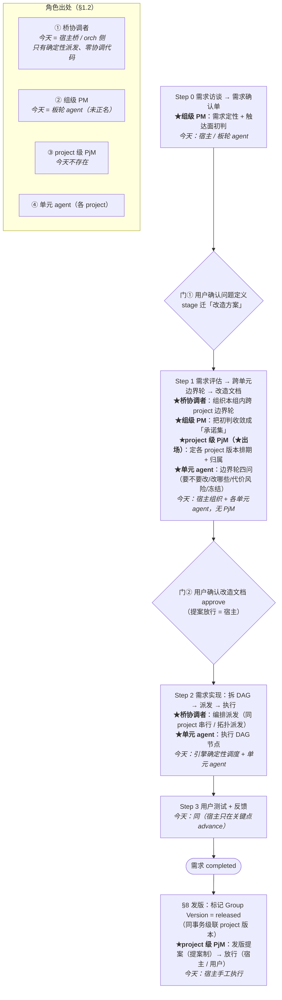

# 需求确认单 — 角色化（组级 PM / project 级 PjM / 桥协调者）

**REQ-ID**: `REQ-2026-10-09-02`（当日全仓序号；本仓 2026-10-09 第二条，前一条为 v0.10.1 的 `REQ-2026-10-09-01`）
**版本归属**: **v0.10.2**（v0.10.x 路线图第 3 增量；路线全文 `doc/v0.10.x/v0.10.x-路线图.md` §2）
**Feature**: `4d7cf009-72d9-45c3-96a6-66f9fb96b296`（`stage=需求分析` / `approval=未发起` / `version=v0.10.2`；2026-10-08 随路线图入板，宿主 Step 0 驱动）
**来源**: 2026-10-05 用户预研裁定（引入 PM / PjM agent 角色）→ 2026-10-08 定档为路线图第 3 增量 → 2026-10-09 用户 Step 0 追加口径（见下 §1.3）
**前置**: v0.10.1（版本下沉 project）—— 代码已四条链 `completed`、改造文档 final；**发版本身尚未执行**（待用户发令）
**Step 0 取证**: **核实完成**（orch inquiry `ec4f5cf7` · board inquiry `e98e8649` · machine inquiry `cf99f8a9`；三者均 `mode="inquiry"` 只读、零改动，2026-10-09T09:3x Z）
**Step 0 状态**: 初稿（v1）已落，**待用户确认问题定义 + 逐项裁决** → 门凭据 = `stage` 迁「改造方案」

---

## 0. 来源说明（诚实登记 · 用户 2026-10-09 要「角色节原文」）

本单「三角色定义」的依据 = **2026-10-05 用户六轮定调** 与 **2026-10-08 用户提供的《Feature 演进与跨 Project 执行及版本模型设计》**。

⚠ **该设计文档未落在本仓** —— 宿主已穷举 `doc/`、仓根 `*.md`、组织工作区（`G:/code/board-code/`）与其余顶层文档，**未见该文件**。本单 §1.2 的「三角色」按 **2026-10-05 预研记录**（项目记忆 `a2a-coding-v010-preresearch`，其中逐字引用了用户当时的裁定与原话）复述 —— **属二手转述、非设计文档原文**。用户要求「先给角色节原文」⇒ 若本单转述与原文有出入，**以原文纠正本单**（请把「角色」章节贴回或落到 `doc/` 下）。

---

## 1. 要解决什么问题

> 本节确认点 =「我理解你要解决的是不是这个问题」——确认的是**问题**，不是方案。

### 1.1 问题一句话

今天「**谁定这个需求做什么、谁给 project 排期与定版本、谁在 project 之间做协调**」三件事，**没有显式角色** —— 职责全部**隐含在宿主 LLM 会话与板轮 agent 的操作里**（引擎侧**零业务角色承载**，见 §3）。本需求把这三个职责**显式角色化**。

> **⚠ 分版（用户 2026-10-09 裁）**：**本版（v0.10.2）只做 project 级** —— 产品经理 / 项目经理（PjM）/ 研发经理 / 单元 agent；**组级**（组级产品负责人 / 桥协调者）**已整体移出本版**，另立卡 **`67c34186`**，其前置（建组即了解各 project 分工）另立卡 **`26bfa4f5`**。**遗留**：本版期间「触达面初判 + 归属裁决」仍由宿主 / 用户手工做。

### 1.2 三角色（2026-10-05 记录为收口 · ⚠ **归属存疑，见 §0 与下方注**）

> ⚠ **§1.2 与 §1.2.1 已被 §1.2.2 / §1.2.3 取代**（角色清单与层级经用户 2026-10-09 多轮订正后收口于 §1.2.2〔清单 + 基数 + 逐步骤〕与 §1.2.3〔层级〕）。本节保留作**修订留痕**，**勿据本节实施**；§1.2.1 的边界逻辑仍有效，但其中称谓「组级 PM」应读作 §1.2.3 的「**组级产品负责人**」。

| 角色 | 层级 | 职责 | 今天是什么（核实见 §3） | 缺口 |
|---|---|---|---|---|
| **组级 PM** | 项目组级 | 需求定性（评估起点是需求，非项目）+ **触达面初判**（天然跨项目） | **板轮 agent** 现状承担、但未正名（职责隐含在 prompt 里） | 缺「定型评估结论档位」（值得做 / 缓议 / 不做）+ per-project 视野 |
| **project 级 PjM** | project 级 | 排期 + 版本归属 + **发版提案**（提案制，球权纪律不变） | **整个角色不存在**（排期 = 用户手拖 · 发版 = 宿主执行） | 全缺 |
| **桥协调者** | 组内 | **本组内**跨 project 协调（跨组后置） | **宿主桥 agent**（从「需求承接」升格为「多角色编排」） | 今天「协调」**全在宿主 LLM 会话里、引擎零承载** |

**层级结构（预研收口）**：桥协调者 → 组级 PM（定性 + 触达面初判）→ project 级 PjM（排期 / 版本归属 / 发版提案）→ 单元 agent（实现 + 边界确认）。

**不设第四角色**：project 级评估由**该 project 的单元 agent 在边界轮**承担（四问 = ①要不要改〔可否决初判退回 PM〕②改哪些〔模块 / 接口 / 文件级〕③代价粗估 + 风险〔契约冲突〕④合账冻结）。

> ⚠ **归属订正（用户 2026-10-09 指出）**：本单原写「**你当时自己的理由是**『评估与实现同一角色、同一份代码知识，评估结论直接长成改造文档』」—— **这是误记**。查宿主记录（`a2a-coding-v010-preresearch`）：该条**未附用户原话**（同一记录中用户的其它表态均带「原话」引号），故「评估与实现同一角色」是**宿主当时的分析理由**、非用户表述；**「只新增三个角色位、不设第四角色」这一收口本身，宿主亦未能在原会话中找到用户明确表态** ⇒ 本单**不再把它写成「用户定案」**，改标为「**宿主推荐 · 用户未明确否决（归属存疑）**」。**用户 2026-10-09 重新提出「是否引入 project 级 PM / 架构师做评估」= 该条已被重新打开**（见 §5 ⑩）。

**宿主 2026-10-05 三条架构建议（尚未被用户明确否决）**：① 载体 = **板轮 agent 角色化**（同一 ACP 后端、不同角色提示词 / 工具面），**不新造引擎实体**，Step 0–3 主链 / DAG / 两道确认门不动；② PM / PjM 产出一律**提案制**（球权纪律不变，agent 直写排期 / 发版不做）；③ 桥身份 per-项目组 ⇒ 协调口径**先做本组内跨 project**、跨组后置。

### 1.2.1 三角色的边界（**组级 PM vs 桥协调者** 的区分 · 用户 2026-10-09 追问）

**一句话**：**组级 PM 管「需求」，桥协调者管「project 之间」。**

| 维度 | 组级 PM | 桥协调者 |
|---|---|---|
| **作用对象** | **一条需求**（Feature） | **project 之间的关系** |
| **回答的问题** | 这条需求做什么 / 值不值得做 / 会落到哪些 project | 触达面定了之后：谁先谁后、资源与席位冲突、跨 project 依赖与契约先后、怎么合 |
| **输入 → 输出** | 需求 → 需求定性（值得做 / 缓议 / 不做）+ **触达面初判**（一个 project 集合） | 触达面 → **执行编排**（顺序 / 冲突裁决 / 依赖） |
| **出现时点** | 需求进入时（**Step 0 起**） | 触达面既定之后（**Step 1 边界轮 / Step 2 派发期**） |
| **工作单位** | 需求 | 组（本组内的 project 集合） |
| **今天是什么** | **板轮 agent** 现状承担、未正名 | **宿主桥**（orch 侧）—— 但今天它**只做确定性派发**（同 project 串行 / 拓扑派发），真正的「跨 project 协调判断」还在宿主 LLM 会话里（见 §3.A-2）⇒ 核实结论 = **零代码对应物** |

**硬边界（建议，待裁）**：

1. **触达面初判属 PM**；**一旦为了可行性要改触达面、改顺序、或处理 project 间冲突 ⇒ 属协调者**。
2. 桥协调者**不改需求内容**（不判断「这个需求该做什么」）；组级 PM **不排 project 的顺序与资源**。
3. 层级 = **桥协调者在上（跨 project 编排）→ 组级 PM 在下（对单条需求定性 + 初判触达面）→ PjM 再下（对单个 project 排期 / 版本）→ 单元 agent 最下（实现）**。

**为什么会混（诚实说明）**：今天两者**载体同类** —— 都是「一个 LLM agent + 一组 a2a MCP 工具」，且板轮 agent 用的就是该组织桥的 **MCP 全集**（§3.B-3）⇒ 名义上是两个角色、实现上看起来像一件事。**这恰是「角色化」要解决的「职责隐含」问题本身**；两者能否落成**可执行的判据**，属 Step 1 的活。

### 1.2.2 各步骤涉及的角色（**收口版** · 2026-10-09 用户裁定「架构师不新建角色」后）

**角色清单（收口）**

| # | 角色 | 层级 | 职责 | 今天是什么 |
|---|---|---|---|---|
| 1 | **组级产品负责人**（★用户 2026-10-09 提出，**替代原「组级 PM」**） | **项目组级** | **① 需求深挖**（直面用户追问，`grill me` 式）· **② 需求定性**（值得做 / 缓议 / 不做）· **③ 触达面初判** · **④ 归属裁决**（方案讨论中某事项 A 可做 B 也可做 ⇒ 判给谁最合适）；**前提 = 了解各 project 分别承担什么职责** | **板轮 agent** 现状承担（未正名）；③④ 无名分、①弱 |
| 2 | **桥协调者** | 组内 | 本组内跨 project 协调 **+「跨 project 契约影响」判据**（原「架构师」候选职责之一，归此）**+ 编排派发** | **宿主桥**（只有确定性派发） |
| 3 | **产品经理**（★**层级订正为 project 级**、非组级） | **project 级** | 本 project **要不要接**（该需求对本 project 是否合理 / 优先级 / 接多少） | 有雏形（边界轮四问 **①「要不要改」**）、未正名 |
| 4 | **项目经理（PjM）** | **project 级** | 排期 + 版本归属 + **发版提案**（提案制） | **不存在** |
| 5 | **研发经理** ★⑭ | **project 级** | 边界轮四问 **②改哪些 / ③代价风险 / ④合账冻结**（= **改造方案**产物：改哪些文件 + 契约影响 + 代价） | 已有雏形（原由单元 agent 兼）、未正名 |
| 6 | **单元 agent** | 各 project | **领任务执行改造**（实现 DAG 节点；含载体升级节点）；**不再出方案** | 已有（⑭ 已裁拆分） |
| — | **用户** | — | 两道门（门① 问题定义 / 门② 改造文档）+ Step 3 验收 + 发版放行（**⑤ 待裁**） | 同 |
| — | **宿主**（编排侧 agent） | — | 今天**实际驱动全流程**；⑧ 待裁 = **本仓宿主亲自驱动的需求先不被角色接管** | 同 |

**角色基数（每个项目组，回答「是不是只有一个项目经理」）**

| 角色 | 基数 | 说明 |
|---|---|---|
| **组级产品负责人** | **1 个 / 组** | 组级唯一的产品面角色（需求深挖 / 定性 / 触达面初判 / **跨 project 归属裁决**） |
| **桥协调者** | **1 个 / 组** | 组内跨 project 协调（跨 project 那一块靠它） |
| **产品经理** | **N 个 / 组** | **每个 project 一个**（「不是每个需求都需要所有项目做改造」⇒ 每 project 对本需求有独立一票） |
| **项目经理（PjM）** | **N 个 / 组** | **每个 project 一个**（排期 / 版本 / 发版节奏各自独立，得有人代表它；若只设一个组级项目经理，会重演 v0.10.1 之前「组级替不相关 project 做决定」的毛病） |
| **研发经理** | **N 个 / 组** | 每 project 一个（⑭ 已裁：方案与实现**分角色** —— 研发经理出方案） |
| **单元 agent** | **N 个 / 组** | 每 project 一个（本就存在；只执行） |

> ✅ **层级已裁（用户 2026-10-09）**：**产品经理 = 项目级**（每 project 一个）；记录中的「PM 层级 = 项目组级」确为**宿主推法**（与 §1.2 同类订正）。⇒ 组级随之改问「**是否引入组级产品负责人**」，见 §5 ⑪；**项目级产品经理的实例化方式**（独立会话 vs 单元 agent 正名）见 §5 ⑫。

> ⚠ **「角色位」≠「运行实例」**：上表是**逻辑职责的基数**；**实例不必常驻** —— 2026-10-05 预研已定 **「按需拉起」**（本仓 4 单元，若产品经理 + 项目经理都常驻 = 8 个会话；按需则在用到时才起）。**这正是待裁 ④「角色形态」的核心。**

**❌ 不新建：架构师**（**用户 2026-10-09 裁定**）。其两个候选职责归位 —— **「本侧怎么改」→ 单元 agent**（实现者、同一份代码知识）；**「跨 project 契约影响」→ 桥协调者**（**新增一条判据**；今天零承载，见 §3.A-2）。

**各步骤涉及的角色（收口）**

| 步骤 | 门 / 产出 | 涉及角色（规划态） | 今天是谁在做 |
|---|---|---|---|
| **Step 0** 需求访谈 → 需求确认单 | 门① 用户确认问题定义（`stage` 迁「改造方案」） | **组级产品负责人**（① 需求深挖〔`grill` 式〕· ② 需求定性 · ③ 触达面初判）+ **用户**（门①） | 板轮 agent（板驱动）/ 宿主 + 用户 |
| **Step 1** 评估 + 跨单元边界轮 → 改造文档 | 门② 用户确认改造文档（`approve`） | **组级产品负责人**（④ **归属裁决**：A 可做 B 也可做 ⇒ 判给谁；初判 → **承诺集**）· **桥协调者**（组织本组内跨 project 边界轮 + 契约影响判据）· **产品经理**（本 project **要不要接**）· **项目经理（PjM）**（★出场：各 project 版本排期 + 归属）· **研发经理**（**改造方案**：四问 ②③④）· **用户**（门②） | 宿主组织 + 各单元 agent（四问含①②③④）；**无 PjM / 产品经理 / 研发经理名分** |
| **Step 2** 实现 | 拆 DAG → 派发 → 执行 → 门禁 | **桥协调者**（编排派发：同 project 串行 / 拓扑派发）· **单元 agent**（**领任务执行** DAG 节点；含载体升级节点） | 引擎确定性调度 + 单元 agent |
| **Step 3** 测试 + 反馈 | 用户验收 → `completed`；分流（增补 / 方案变 / 新需求） | **用户**（验收）· **组级产品负责人**（分流定性）·（宿主 `advance` 驱动） | 同 |
| **§8 发版**（独立于需求流程） | 标 Group Version = `released`（同事务级联 project 版本） | **project 级 PjM**（发版提案）· 放行方（**宿主**，用户 2026-10-09 答；⑤ 与 83136097「用户按钮」冲突待裁）· **宿主**（文档审核 / CHANGELOG / 回归 / commit·tag·push / 回写 `stage=发版`） | 宿主手工执行 |

### 1.2.3 角色层级（**整理版** · 2026-10-09）

**两层角色 + 两个外部方 · ★ = 用户 2026-10-09 提出、待裁标记**

```
用户（外部 · 最终决策）
  门① 确认问题定义 · 门② 确认改造文档 · Step 3 验收 · 发版放行
        │ 放行 / 打回
        ▼
═══ 组级（项目组 · 全区 1 套）══════════════════════════════════════════
  ├─ 组级产品负责人 ★⑪〔待裁〕              桥协调者
  │    ① 需求深挖（grill，直面用户）         · 本组内跨 project 协调
  │    ② 需求定性（值得做 / 缓议 / 不做）     · 跨 project 契约影响判据
  │    ③ 触达面初判                        · 编排派发（同 project 串行 / 拓扑派发）
  │    ④ 归属裁决（A 可做、B 也可做 ⇒ 判给谁）
        │ 触达面 + 归属（下游输入）            │ 横切：边界轮 / 派发
        ▼                                    ▼
═══ project 级（每个 project 各 1 套 · ×N）══════════════════════════════
  ├─ 产品经理 ──▶ 本 project 接不接？（要不要做 / 优先级 / 接多少）
  ├─ 项目经理 PjM ──▶ 排期 · 版本归属 · 发版提案（提案制）
  ├─ 研发经理 ★⑭ ──▶ 改造方案（改哪些 / 契约影响 / 代价）〔⑭ 已裁：从单元 agent 拆出〕
  └─ 单元 agent ──▶ 领任务执行改造（实现 DAG 节点 · 不再出方案）

宿主（编排侧 agent）：今天实际驱动全流程 —— ⑧ 待裁：本仓宿主亲自驱动的需求先不被角色接管
会话事实：contextId 是节点级 —— 每个任务节点独立上下文，无跨节点常驻会话
```

| 层级 | 角色 | 一句话职责 | 基数 |
|---|---|---|---|
| **组级**（项目组） | **组级产品负责人** | ①需求深挖（`grill` 式）②需求定性 ③**触达面初判** ④**归属裁决**；前提 = 了解各 project 分工 | **1 / 组** |
| **组级**（项目组） | **桥协调者** | 本组内跨 project 协调（**跨 project 契约影响**判据 + 编排派发） | **1 / 组** |
| **project 级** | **产品经理** | 本 project **接不接**（该需求对本 project 是否合理 / 优先级 / 接多少） | **N / 组** |
| **project 级** | **项目经理（PjM）** | 排期 + 版本归属 + **发版提案**（提案制） | **N / 组** |
| **project 级** | **单元 agent** | 边界轮四问 **②改哪些 / ③代价风险 / ④合账冻结** + **实现** | **N / 组** |
| —（外部） | **用户** | 两道门 + Step 3 验收 + 发版放行（⑤ 待裁） | — |
| —（外部） | **宿主**（编排侧 agent） | 今天**实际驱动全流程**；⑧ 待裁 = 本仓宿主亲自驱动的需求先不被角色接管 | — |

**决策流（一条需求走一遍）**：需求 → **组级产品负责人**（定性 + 触达面初判 + 归属裁决）→ 各 **产品经理**（接 / 不接）→ 各 **项目经理**（排期 / 版本）→ 各 **单元 agent**（改哪些 / 实现）；**桥协调者横切**：触达面既定后组织边界轮（契约影响）并编排派发。

> ⚠ **四处口径提醒**：**(1)** 「角色位」≠「运行实例」（按需拉起，见下注）；**(2)** **组级产品负责人 ≠ project 级产品经理**（前者跨 project 定归属，后者只判本 project 接不接）；**(3)** 组级产品负责人与桥协调者的**共同前提** = 「**了解各 project 分工**」，**今天零承载**（§1.3-1），没有它两者都只能靠猜；**(4)** **project 级的「改造方案」与「实际改造」已裁为「分角色」**（§5 ⑭，用户 2026-10-09）：**研发经理**出**改造方案**（改哪些 / 契约影响 / 代价），**单元 agent** 只**领任务执行**。**依据** = `contextId` 是**节点级**（「新增业务节点 ⇒ 新 `contextId`」，见 `AGENTS.md`「会话复用与上下文纪律」）⇒ 方案与实现**本来就在不同会话 / 上下文**，故**分角色的边际成本 ≈ 0**。**区分点**：**产品经理 =「要不要做」** · **PjM =「什么时候做 / 进哪个版本」** · **研发经理 =「怎么做」** · **单元 agent =「照方案做」**。**⚠ 注**：该拆分**不等于「独立校验」**（两侧**同模型同仓** ⇒ 盲区可能相同），故须配套**判据** —— 方案必须落「**改哪些文件 + 契约影响 + 代价**」，验收按**工作树指纹**核对「方案说改的」与「实际改的」。**⚠ 历史订正**：本单 v12 曾以「评估与实现同一角色、**同一份代码知识**」为理由 —— **不成立**（项目侧无常驻会话，每节点读仓起步）。

### 1.3 用户 2026-10-09 追加口径（Step 0 定稿输入 · 三条）

1. **组级 PM 有前置**：用户原话「**这个好像需要 orch agent 本身对下属项目要有了解才好定吧（我希望可以独立一个需求：即创建 projectGroup 并关联 project 的时候，要能够去触发了解 group 下各 project 的分工，这样组级 PM 才有意义吧）**」⇒ 组级 PM 若要立起来，前置能力 = 「**建组 / 关联 project 即触发了解各 project 的分工**」，用户希望**独立成一个需求**。
2. **project 级 PjM 要做**：用户原话「**这个要做，在方案讨论阶段出现，确定各 project 的版本排期**」⇒ 出场时点 = **方案讨论阶段（= Step 1 边界轮）**，产物 = 各 project 的**版本排期**。
3. **桥协调者**：用户原话「**这个当前不就是 orch agent 吗？**」⇒ 用户认为桥协调者 ≈ 今天的 orch 侧 agent。

### 1.4 当前行为（三单元只读核实，逐条 file:line 见 §3）

1. **引擎侧零业务角色**：orch / machine 全库 grep `PM / PjM / coordinator / project manager` **零命中**；唯一的 `role` 字段 = **进程租约角色** `owner|follower`（与业务无关）。
2. **板轮 agent 已实际承担「组级 PM」的活**（但未正名、职责散落在 prompt 文本里）：需求定性、状态机推进（approve / advance / cancel 全在它手里）、v0.10.1 的**归属（承诺集）初判**也在它那里 —— **但板代码对 project 归属零感知**，板自身不写状态机，一切经 agent 会话内的 MCP 落引擎。
3. **「桥协调者」今天没有代码对应物**：桥的跨 project 部分只是「同 project 串行」的忙集过滤（FIFO / 预留式），**跨 project 依赖、冲突仲裁、合并排序队列全部不存在**；「协调」职责全在宿主 LLM 会话里。
4. **无 agent 自主发起的编排通道**：写意图 = 宿主经 MCP / 板经 HTTP；自动流转 = 引擎**确定性代码组件**（scheduler tick 等）。**不存在**「某个 agent 侧自主派活 / 自主流转」的路径。
5. **提案制今天无承载**：orch 里**没有**任何 pending / 提案 / 待放行实体；唯一形似的「意图挂起 → 显式放行」结构 = Feature 的 `approval` 三态门（未发起 / 待审批 / 已通过），但它挂在 Feature 上、不是通用 pending 实体。
6. **身份校验只到「组」，区分不了「谁代表哪个 project」**：MCP 连接身份 = URL 首段组名（注释明写「**组不是鉴权边界，仅是视野隔离**」）；归属写的 `projectId` 只是字符串参数、**无「调用者是否代表该 project」的校验**；`source` 是自由文本、MCP 路径硬编码 `"mcp_advance"`。
7. **板侧区分不了「这一轮是哪个角色 / 哪类动作」**：轮台账 `TurnRecord` 无 kind / role 列，动作档只差在 **prompt 标题行**（纯文本）；会话键只有一族 `contextId = "board-" + uuid`、**按 requirementId keyed 终身复用**；**无 `release:<version>` 式版本级 / 角色级会话键**，且发轮通道**要求非空 `requirementId`** ⇒ **版本级动作今天没有会话槽位**。
8. **machine 侧无角色概念、也无「会话级角色」通路**：`DispatchCommand` 字段 `{taskId, projectId, contextId, payload, claimToken?, readOnly?}` **无角色字段**；同一 project 的 `systemPrompt / model / risk` 全是**进程级**，角色无法在同一进程内区分注入。

### 1.5 期望行为

1. **三个角色有显式定义与出场时点**（谁在什么阶段做什么），不再靠人记「这活今天归谁」。
2. **project 级 PjM 在方案讨论阶段（Step 1 边界轮）出场**，产出各 project 的**版本排期**（= 把 v0.10.1 的 **C-6 代行档**〔边界轮各单元自报候选 + 用户过门确认〕**正名并制度化**；**不是本版才缺个决定者**）。
3. **PM / PjM 产出一律提案制**：只提，不自己拍板；**放行方 = 宿主（编排侧 agent）**（用户 2026-10-09 裁定，见 §5 ⑤ 的冲突提示）。
4. **角色化不改主链**：Step 0–3 主链 / 两道确认门 / DAG 派发 / 调度串行语义不动（合 §6）。
5. **本仓宿主亲自驱动的需求先不被角色接管**（预研待裁 ⑥ 的推荐，待确认）。

---

### 1.6 本版交付范围（**简明** · 2026-10-09 · ⚠ 含待裁开关）

**一句话**：把今天隐含在宿主与板轮 agent 里的职责**显式角色化**，并让**每个角色能各配 agent / model**。

**A. 角色（显式化 + 拆角色）**

| 层级 | 角色 | 本版做什么 |
|---|---|---|
| project 级 | **产品经理** | **正名**：本 project **接不接**（= **并入边界轮四问①**，不新增工序 —— ⑫ ✅） |
| project 级 | **项目经理（PjM）** | **新增一道工序**：**改造方案确认后**做**版本规划评估 → 确定各 project 版本**（+ 版本归属 + 发版提案）—— ② ✅ |
| project 级 | **研发经理** | **出改造方案**（改哪些 / 契约影响 / 代价） |
| project 级 | **单元 agent** | **只领任务执行**（不再出方案） |
| ~~组级~~ | ~~桥协调者 · 组级产品负责人~~ | **❌ 本版不做 —— 已拆出**（用户 2026-10-09 裁「组级的角色定义放到下一个版本去」）⇒ 另立卡 **`67c34186-2a77-4f73-aaf9-41f1c579daa7`**（组级角色化） |
| — | **架构师** | **不新建**（已裁 ⑩） |

**B. 机制**

1. **`task_type`**：`a2a_call` 新增**任务级属性**（照 `readOnly` 同形）；**闭集**且 **orch 与 machine 同一份值域**（照 `AGENT_KINDS` 先例：各自派生 + 回归断言锁一致）；**缺省 = `unit_agent`**；machine 配置层有 **`task_type → agentKind / model` 映射面**。
2. **machine 会话级注入**（⑮ **承重点**）：把 `systemPrompt / model / risk` 由**进程级降到会话级**。
3. **启动自检**：只跑 `unit_agent`；其它角色**只做配置级校验**（不真跑）。
4. **提案制**：PM / PjM 只提，**放行方 = 宿主**（⑤ 已答）。
5. **会话复用键 = 「需求 × step（角色）」**（**用户 2026-10-09 附加硬要求**）—— **同一需求的同一个 step 内，多轮派发必须复用同一 `contextId`**（= 续接同一后端会话）；**跨 step / 跨需求开新**。这**收窄**了现行纪律「**每个新任务节点开新 `contextId`**」（`AGENTS.md`「会话复用与上下文纪律」）。**已知利好**：machine 侧**已有** `contextId → ACP sessionId` 的 `load→resume→new` 阶梯（`acp-bridge/acp/session.ts:5,676`，映射落盘 `.a2a/acp-sessions/<projectId>.json`）⇒ **只要 orch 送同一个 `contextId` 就能续上同一会话**，**machine 侧可能零改动**（待 Step 1 核实）。**落地要点**：`contextId` 不能再「每个新节点随机新生成」，须由 **`(featureId, step/角色)` 派生**（或 orch 维护 `(feature, step) → contextId` 映射）。**⚠ 与 ④ 的关系**：这正是 A 档（角色=派发属性）能落地的前提 —— 会话**不是常驻身份**，而是**在 step 粒度内复用**。

**C. 连带 / 前置（均已裁）**

- **板上发版按钮 `83136097`** —— **❌ 本版不做**（用户 2026-10-09 裁「先不做」）；该卡继续留在池里。
- **「建组 / 关联 project 即触发了解各 project 分工」** —— **已另立卡 `26bfa4f5-f02e-4e7c-9428-f6bdf990becb`**，**连带组级一起落下一版**（它是组级两角色的**共同前提**）。

**D. 不做**（详见 §6）：不碰主链 / 两道门 / DAG · 不做跨组协调 · 不做 semver / 生命周期 · 不做 Rollback·Hotfix · **不做部署解耦**（已另立卡 `af5f6b0a`）· 不做 polyrepo 真机。

**⚠ 本清单已按 2026-10-09 裁定收敛**：**⑬** 分版（组级后置）· **⑥** 板发版按钮不做 · 组级两角色与前置卡已拆出另立卡 · **⑫** 产品经理并入边界轮 · **②** PjM **新增一道「版本规划评估」工序、出场于改造方案确认后** · **⑧** **本仓需求也接管** · **⑨** 角色职责**写进 `flow` 规范**。**唯一待你点头**：**④** 角色要不要真起 agent 会话（**宿主建议 A**，实现说明见 §5.1 注）。

## 2. 影响范围（粗判）

| 单元 | 触及面（粗判） | 依据 |
|---|---|---|
| **orch** | **非零（⑮ 裁定「走乙」后确定）**：新增**业务角色**概念 + 角色 → `agentKind` / model **映射面** + `toDispatchCommand` 扩下发字段（`bridge/runner.ts:1557`）；**协议 major 变更**（须与 machine 硬切同升，见 §3.D）。另有：提案 / 角色身份**承载**（今天只到「组」）、归属写的身份维度、是否开 MCP 发版口 | §3.A / §3.D |
| **board** | 板轮 agent **角色化**（提示词 / 工具面 / 台账 / 路由四层今天**均无角色承载** = 净新增面）；版本级会话槽位（今天要求非空 `requirementId`）；连带卡 83136097 发版按钮落点 | §3.B |
| **machine** | **不再是零改动**（若采纳 ⑮「角色须区分 agent / model」）⇒ 须走 **C 档会话级注入**：`DispatchCommand` 加**可选**字段（角色 / `agentKind` / model）+ 透传 + 桥把注入**由 runner 级降为 session 级**（`runner-exec.ts:305-326`；`acp-bridge/index.ts:378-395`、`acp-bridge/acp/session.ts:1070+`）—— **协议按 `readOnly` 同形可不升版**（先例 = 任务级可选键 + 未知字段忽略 + 协议仍 2.3；严格档才走注册期能力协商。详见 **§3.D**）。**B 档**（一角色 = 一 project，纯配置零代码）为备选，代价 = 须重启 + 进程 / 端口线性涨 + 自检涨 + `idleStopMs` 回收冷角色；**A 档（零改动）不可行**（无法按角色区分注入） | §3.C-6 |
| **flow** | 若要写「角色职责 / 出场时点」进规范 ⇒ `需求流程.md` 文本增补（角色节 · 提案制 · 出场时点） | 预研 |
| **根** | 无（除非新增一次性脚本） | — |

---

## 3. 关键核实结论（三单元只读 · 2026-10-09）

> 「当前行为 / 影响范围（粗判）/ 技术可行性假设」由执行单元核实，orch 不单方断言。**以下均为单元回执，file:line 为当前 master（v0.10.1 后）实况。**

### A. orch（`ec4f5cf7`）

1. **业务角色抽象零命中**：`role` = core 租约角色（进程调度权），值域仅 `owner|follower`（`runtime/core-lease.ts:47,67-68`；取得 `runtime/lifecycle.ts:222-248`；`/health` 报出 `bridge/transports/http.ts:290`）。全库 grep `coordinator / PM / PjM / project manager` = 零命中。形似「角色」但都**不是**业务角色的三样：`agentKind`（后端 CLI 类型闭集 `types.ts:16-19,429`）· `projectGroup`（组织可见性分组，连接身份 `bridge/transports/http.ts:11-14`）· 工具描述里「orch agent 驱动 Feature 主链推进」字样（`bridge/register-tools.ts:470`，**仅文案、无代码实体**）。
2. **「桥协调者」零代码对应物**：协调类逻辑**只有**「同 project 串行」，实现就是忙集过滤（`bridge/scheduler.ts:279-311`；忙集 `:47-51,518-535`）。**不存在**：跨 project 依赖协调（依赖三态只看**本 Feature 内**节点态 `:237-259`）、冲突仲裁 / 合并排序队列（竞争失败者本批跳过、下 tick 重算 `:50-51`）、跨 project 闸（设计即无）。
3. **驱动方**：写意图 = 宿主经 MCP（`bridge/index.ts:994-1036`；`approve/advance/cancel` 见 `bridge/register-tools.ts:466-569`）/ 板经 HTTP；自动流转 = 引擎确定性代码组件（scheduler `setInterval` tick `bridge/scheduler.ts:99,566-567`；`executing→integrating` 全 completed 自动 `:853`；版本 `notstart→active` 自动 `bridge/versions-activation.ts:4`）。**全库无「由定时器触发 LLM/agent 自主派活」的路径。**
4. **归属写面**：**唯一入口 = MCP `a2a_feature_advance(projectVersions[])` 独立分支**（`bridge/register-tools.ts:522-547` → `bridge/feature-tools.ts:1446-1476,1497-1510,1563-1570` → `applyFeatureAttributions :865-904` → `session/store.ts:4506,5436`）；**无 HTTP 归属写端点**（`bridge/project-versions-endpoints.ts:21-27` 只有 GET/POST/DELETE 台账口）。**身份校验两层都到不了 project**：MCP 面只校验组归属（`bridge/feature-tools.ts:385-408`，注释「组不是鉴权边界，仅是视野隔离」`:380`）；HTTP 面 `owner_group`/`project_id` 皆调用方自报（`project-versions-endpoints.ts:213-238`）、无鉴权。`source` 自由文本、MCP 路径硬编码 `"mcp_advance"`（`feature-tools.ts:1455`）⇒ **只区分通道、不记录身份**。
5. **无提案中间态**：`feature_projects` **没有 status 列**（`session/store.ts:1830`；测试锁定 `test/v0101-o1-project-versions.test.ts:242-257`）；`project_versions` 仅 `open/released` 两态（建版恒 open `project-versions-endpoints.ts:244-251`）。唯一「意图挂起 → 显式放行」结构 = **Feature `approval` 门**（登记 `register-tools.ts:513-519`；放行 `feature-tools.ts:1747-1759`）——形状可作提案制蓝本，但**挂在 Feature 上、非通用 pending 实体**。
6. **闸的触发方**：`checkVersionLedger`/`checkVersionWriteLocks`（`feature-tools.ts:505,544`）调用点只有 `handleFeatureCreate`（`:1021-1025`）与 `handleFeatureAdvance`（`:1430-1434`）—— 凡写 `features.version` 的 **MCP 路径过锁**，板专用 HTTP 台账口**不过**。`evaluateReleaseGate`（`:609-649`）唯一生产链 = **板发 HTTP 意图** `PATCH /api/versions/{version}/status{released}`（`versions-endpoints.ts:526-558`）→ `markVersionReleased`（`versions-release.ts:181`）→ 闸 → 同事务级联 project 台账（`:148-149`）⇒ **发版闸今天由板触发、引擎执法，无 MCP 发版口**。project 侧 `evaluateProjectReleaseGate`（`feature-tools.ts:942-956`）明确定为**展示字段、非门**。

### B. board（`e98e8649`）

1. **板轮 agent 四条起轮路径**（全汇到同一发轮通道）：人工「触发一轮」`POST /features/:id/turn`（`server.ts:1804-1805` → `handleWriteTurn :3179-3224` → `host-face.ts:826-876`）· 人工「确认」`POST /features/:id/confirm`（`kind="confirm"`）· 自动接力（轮收口回调 `host-turn.ts:1087-1094` → `host-relay.ts:207-224`）· 心跳唤醒（`heartbeat.ts:269-294` → `host-face.ts:763-784`）。
2. **prompt 四个纯函数**（均追加 `RECEIPT_CONTRACT`）：`buildTurnPrompt`（`host-face.ts:204-238`）· `buildConfirmPrompt`（`:246-262`）· `buildRelayPrompt`（`host-relay.ts:207-224`）· `buildWakePrompt`（`heartbeat.ts:269-294`）。共同硬口径：**不出现任何 MCP 工具全名**。
3. **今天承担的职责**（隐含在 prompt 指令里）：按阶段产出文档（`host-face.ts:219-220`）· 需要人决策用 input-required 收口（`:221`）· **状态机推进（approve/advance/cancel）由 agent 经编排桥执行**（`:222`）· **v0.10.1 归属（承诺集）初判也在 agent 会话内**（板 prompt 只带 featureId/org/version `:215`，对 project 归属零感知）。工具面 = 桥以 `--risk write` 拉起后端（`host-bridge.ts:223-224`）、注入该组 a2a MCP 全集 ⇒ agent 有全工具面；**板自身不写状态机**（`host-face.ts:19-22`）。
4. **轮台账与生命周期**：`.data/host-turns.json`（`host-turn-ledger.ts:34-37`）；轮态七值 `queued/running/awaiting_answer/succeeded/failed/canceled/timeout`（`:44-51`）；**单轮缺省 10min**（`host-turn.ts:68`，config 键 `turnTimeoutMs` 可覆盖）；input-required → `awaiting_answer`、**不是失败**（`host-turn.ts:14-17,110-121`）；确认模板 = `buildConfirmPrompt`（「按钮不是批准」→ 只读核对 → 通过才经桥 approve）。
5. **板侧区分不了角色 / 动作**：`TurnRecord` 无 kind/role 列（`host-turn-ledger.ts:79-105`）；动作档只差在 prompt 标题行（文本）；会话键只有 `board-<uuid>`、**按 requirementId keyed 终身复用**（`host-turn.ts:80,174-176`）；**无任何 `release:<version>` 式版本级 / 角色级会话键**，且发轮通道**要求非空 `requirementId`**（`host-turn.ts:687-688`）⇒ **版本级动作现无会话槽位**。
6. **发版按钮（83136097）三条复核**：(a) **成立** —— 路由仍钉死 featureId（`write-guard.ts:160-161`）；(b) **量级成立但半句已作废** —— `POST /versions` 靠 action 三值闭集分流仍在（`write-guard.ts:761-808`，闭集 `create/remove/setStatus`，旧引 `:602-649` 已漂）、`buildReleasePrompt` 全 src 零命中需新增、handler 与 `handleWriteTurn`（46 行）同量级；但 v0.9.6 确认单写的「前置闸复用 `version-transition.ts:102-111`」**今天已失效**（v0.10.0 B2 起板不判闸，三支全改道引擎，`decideVersionTransition` 在 `src/` 已无调用者）；(c) **成立且多一层匿名档** —— 派发 org 解析仍只有需求级 `ownerGroup` 与空间路径 `spaceOrg` 两条，全局直投 ⇒ `spaceOrg=null` ⇒ **引擎匿名档 `ownerGroup:null`**。
7. **板侧 project 级版本视图** = 组织空间排期页**只读** section（`views.ts:2173-2240`；`server.ts:930-934`），三档显示闭集 `live/empty/absent`，不重算 `releasable`。**板侧现成「向引擎发意图」写封装四个**：`versions-write.ts`（POST/DELETE/PATCH 版本口，**发版按钮最直接复用面**）· `feature-schedule.ts`（排期写，类型层封死 stage/approval）· `requirement.ts`（`a2a_feature_create` 唯一写点）· `group-admin.ts`（组织组写）。

### C. machine（`cf99f8a9`）

1. **无业务角色**：`agentKind` = 后端 CLI 类型闭集 `["opencode","codex","claude","qoder-cn"]`（`agent-kinds.ts:11`）+ 加载期校验（`config.ts:69-72`）；另有 `risk`（项目级静态 `types.ts:36,54-58`）与 `readOnly`→lane（单次派发级 `runner-exec.ts:549-554`）。`role` 命中全是 A2A 消息角色字面量。
2. **进程模型**：Launcher 常驻一机一实例（`launcher/index.ts:359-384`）；**Runner 不是独立进程**、是 Launcher 进程内的出站循环（`launcher/runner.ts:428,500-517`）；一 project = 一子进程链（桥 + 其后端）。**配置只在进程启动读一次**（`launcher/index.ts:46-47`；全仓 `fs.watch|reloadConfig|SIGHUP` **零命中**）⇒ 改 `config.json` **必须重启 Launcher**。
3. **现成「按需」机制三条**：幂等按需拉起 `ensure()`（`manager.ts:452-481`）· 用完自动回收（`manager.ts:227-277`，判据按项目在飞计数）· **会话级按需**（`contextId → ACP sessionId`，`load→resume→new` 阶梯 `acp-bridge/acp/session.ts:5,676`）。
4. **machine 不参与板 host-turn**：入站业务路由**已退役**（`launcher/server.ts` 只有 `/health` + 可选 `/shutdown`，`:184-206`）；唯一入口 = 桥经 `/runner/connect` 下发 `dispatch|stop|cancel-task`（`runner-exec.ts:302,1371-1381`）；`DispatchCommand` = `{taskId, projectId, contextId, payload, claimToken?, readOnly?}`（`:305-326`）—— **无角色字段**。
5. **两把并发闸纯按 projectId**、与角色**零关联**（`runner-exec.ts:598-674`，注释「按 project 计、与项目组正交」`:590-591`）。
6. **「独立会话 + 按需拉起」三档成本**：**A 档** 不经 machine（零改动；局限 = 同 project 的 `systemPrompt/model/risk` 全是**进程级**，角色无法同进程区分注入）· **B 档** 一角色 = 一 project（纯配置零代码；代价 = 须重启 Launcher + 每角色一套进程/端口 + 自检线性涨 + `idleStopMs` 会回收冷角色）· **C 档** 真·会话级角色（**最小但非零代码** = `DispatchCommand` 加可选字段 → 透传 → 桥把 injection 从 runner 级降为 **session 级**消费；协议判据「字段可被对端完全忽略且不影响判定 ⇒ 不升版」，先例 = `repo` 沿用 2.3）。

---

### D. 追加核实：桥能否决定 project 的 agent / model（orch `0952d59c` · 用户 2026-10-09 追问）

**结论：不能 —— 桥侧零决定、零透传。**

1. **桥侧「决定 project 的 `agentKind` / model」的代码与配置 = 零**。**规范明文**（`orch/types.ts:41`）：「orch 侧仅据此作**闭集校验 / 投影** —— 『决定**执行层后端（ACP 桥 / 适配器）与 CLI 参数**』属 **machine 侧语义**」。派发入参 `a2aCallSchema` 键全集（`bridge/register-tools.ts:79-125`）**无 `agentKind` / `model` / `role`**。
2. **桥 → machine 的 `dispatch` 载荷字段全集**（类型 `bridge/runner.ts:288-311` · 装配 `:1557-1574` `toDispatchCommand` · 线协议 `PROTOCOL.md:70`）：`command / taskId / projectId / contextId / commandId / message / claimToken / featureId / dependencies / inputs / readOnly?` —— **不含任何 agent / 模型 / 角色类字段**。
3. **`runner_projects.agentKind` = 记录 machine 上报值**，orch 只做闭集校验：写链 `POST /runner/register`（`bridge/runner.ts:121,884`）→ `parseProjects`（闭集校验 `:1458-1463` + 原样取值 `:1478`）→ `store.runnerProjectsReplace`（`session/store.ts:2810-2853`）。orch 其余出现点全是**投影拷贝**。
4. **`projectGroup` → `agentKind` / model 映射 = 零**：`ProjectGroup` 成员只有 `{machineId, projectId}`；组的用途是**可见性 / 连接身份**，不是「按组配 agent」。machine 的 `agentConfig` 在 orch 出口被**显式剔除**（`bridge/index.ts:238` 等）。
5. **v0.9.5 `hostModel` = orch 零命中**，作用面 = **板宿主桥自身**（board 侧）⇒ **被派发到 project 的 DAG 节点取不到任何 hostModel**。
6. **`model` 在协议里根本不存在** —— 连 machine 上报都不带（`PROTOCOL.md:34` 的 `projects[]` 字段集无 `model`）⇒ 「按 model 记账 / 展示」今天**零承载**。

**⇒ 两条路（桥侧改动量差一个量级）**

| 路 | 桥侧改动 | 代价 / 风险 |
|---|---|---|
| **甲：一角色 = 一 project** | **零**（决定权留在 machine 本机配置，machine 已按 `projectId` 各配 `agentKind`） | 角色数被 project 数**钉死**；同一 project **无法按轮换角色**；每角色一套进程 / 端口 / 自检（machine B 档）；**污染项目面** |
| **乙：同一 project 按角色切 agent / model** | **非零**：需 **(a)** 新增**业务角色**概念（现有 `role` = 进程主备 `owner/standby`，**不可复用**）**(b)** 角色 → `agentKind` / model 映射面 **(c)** `toDispatchCommand`（`runner.ts:1557`）扩下发字段 | **(c) 做可选键 ⇒ 未升级 machine 静默忽略 = 假透传**；**做必填 ⇒ 协议 major 2.x→3.0 + 两侧硬切同升** |

**⇒ orch 侧的最省形态（用户 2026-10-09 提议 · 宿主复核成立）**：**不需要新建「业务角色」实体** —— **加一个任务级属性 `taskType` 即可**：`a2aCallSchema` 加键（`bridge/register-tools.ts:79-125`）→ 落 `QueuedTaskRecord` → `toDispatchCommand` 下发（`bridge/runner.ts:1557-1574`）。**协议面**：**可选**则不升版（`readOnly` 先例 = 任务级可选键 + 未知忽略 + 协议仍 **2.3**）；**用户已改定「缺省 = `unit_agent`」⇒ 字段可选 ⇒ **不升版**（见 §5 ⑮ 的协议口径订正）。**值域**：闭集、**orch 与 machine 同一份**（`AGENT_KINDS` 先例：两侧各自派生 + 回归断言锁一致），machine 配置层需有 `task_type → agentKind / model` 映射面。**非引擎路径**（板宿主桥拉起的轮 / machine 启动自检）**由各自发起方填**。**真正承重的仍是 machine 侧**：`systemPrompt / model / risk / backendCmd` 今天在**进程级**，必须降到**会话级**消费。

**仍未核实（Step 1 前须补）**：① machine 侧 `DispatchCommand` 消费面与 `agentConfig` 是否**已有 model 维度**；② board 侧「agent 按项目组生效」与 `hostModel` 的**确切作用对象**。

### E. 追加核实：非引擎 task 路径（board `925922fa` · machine `1841c534` · 用户 2026-10-09 追问）

**问题**：除 orch 派发外，还有哪些路径会拉起 agent？「板宿主桥」到底是什么？

**board 侧 —— 板轮的进程由板自己 spawn**

1. **板触发一轮时，进程是板自己 spawn 的**：`triggerTurn`（`host-face.ts:826`）→ `startBridge`（`:1000-1020`）→ `HostBridgeManager.ensureStarted`（`host-bridge.ts:560`）→ **spawn 点 `host-process.ts:214`（win32）/ `:225`（posix）**。spawn 内容 = **`node <仓根>/machine/dist/acp-bridge/index.js`**（动态空闲端口、cwd = `<orgsDir>/<组织>`、`--risk write`、`--mcp-servers-json`），桥再以 stdio 拉起后端 CLI ⇒ **「桥 + 后端」两级进程**（`host-bridge.ts:5,8`）。
2. **不经 machine Launcher（零痕迹）**：明示声明 `host-turn.ts:30`「**不走 Launcher**：端点 = 板自己 spawn 的桥端口」；`host-bridge.ts:247`「板管的桥**不进 Launcher 台账**」；全板 `launcherUrl` / `:3010` / `:3013` **零命中**。
3. **machine 配置里的 `board` 条目 ≠ 板轮**（**订正宿主先前误引 `:56-64`**，实为 `machine/config/config.json:46-56`）：它服务的是**另一条路** —— **orch 经 `a2a_call` 派发 project `board`** 时由 machine Launcher 在 **3013** 起桥；与板轮的 workspace、kind/model 来源、端口**全都不同**。
4. **「不经 orch」只对「拉起 / 派发」成立**：板轮 agent 的 **MCP 端点 = orch 桥 `http://127.0.0.1:8787/<组名>/mcp`**（`host-bridge.ts:192-194`；实配组名 `a2a-coding`）⇒ **工具面仍回头打 orch**。
5. **kind / model 来源 = 板自己的配置 + 板组织台账**（`board/config/config.json` 的 `hostKind` / `hostModel`；`.data/orgs.json` 的 `agentKind` / `agentModel`；回落序 `host-face.ts:557-567`）—— **不经 orch、也不经 machine 配置**。machine 侧只被**动态加载构建产物**（`host-runtime.ts:160-184` 读 `machine/dist/adapters/index.js` 取 kind 值域与 argv 拼装 —— **读它的代码，不读它的配置**）。

**machine 侧 —— 不经 orch 的 task 只有一类：启动自检**

6. **task 来源穷举**：全机只有 **1 个入站族（orch `/runner/connect` dispatch）+ 1 个本机自产（启动自检）**；`stop` / `cancel-task` 只走控制通道、**零 prompt**；`reconcile*` 只杀孤儿 / 造 failed 账单；**入站业务面已退役**（`/projects` 等一律 404）⇒ 外部**无法直连** `ensure`。
7. **启动自检**（`self-check.ts:194,228,265`）：按 `projects[]` **全量 · 每 project 恰 1 条 · 串行 · 本机 loopback 直跑**，**与 orch 是否在跑完全无关** ⇒ **「board 会被 machine 自己拉起」的唯一成因就是它**。
8. **自检结论 orch 不消费**（`selfCheck` 在 orch 仅 `README.md:76` + 一处测试样本命中）⇒ 今天只是**观测面**。
9. **自检成本（硬数据）**：每 project 一条**真模型对话**；本机 8 project；成功态 = codex 2.0–3.1s / qoder-cn 5.1–6.2s / opencode 11.3s，**最坏 8×120s = 960s**；真机实测一轮 **约 10.5 分钟**才 `ready=true`。**且是前台阻塞**：自检未过前 `ready=false`，**Runner 出站循环在自检之后才创建**（`index.ts:343-356`）⇒ **自检期间这台机对 orch 完全不可见**。
10. **已在吃真实配额**：日志里自检失败原因直接是 `Go usage limit exceeded` / `429 rate_limit`。
11. **若改成「每 project × 每 task_type 各真跑一条」= ×K**：条数 ×K · **墙钟 ×K**（K=3 ⇒ **最坏 ≈48 分钟阻塞 + 48 分钟对 orch 隐身**）· 配额 / 限流概率 ×K · **且若某 `task_type` 是写档，自检会真改 workspace 文件，而自检没有任何文件回滚面**（只有 `manager.stop()` 杀进程树）⇒ **留下脏工作树**。
12. **前置事实**：`task_type` 在 orch / machine **两侧源码零命中**；现状唯一任务种类维度 = `readOnly → lane='read'|'write'`（`runner-exec.ts:549`）。

**为什么板不直接拉 CLI，而要经 acp-bridge（用户 2026-10-09 追问）**

13. **因为板驱动一轮走的是 A2A JSON-RPC，不是往 CLI stdin 灌字** —— 板轮的对话通道 = **POST `http://127.0.0.1:<动态端口>/a2a/jsonrpc`**（`host-turn.ts:30`「端点 = 板自己 spawn 的桥端口」、`:354-355` `bridgeRpcEndpoint`）。**要有一个「说 A2A 的端点」，就得有桥**。桥同时承担五件事：**会话映射**（`contextId → ACP sessionId`，`acp-bridge/acp/session.ts:5,676`，含 `load→resume→new` 阶梯与落盘 `.a2a/acp-sessions/<projectId>.json`）· **权限档**（`--risk`）· **MCP 注入**（`--mcp-servers-json` → ACP `session/new` 的 `mcpServers`，`acp-bridge/index.ts:177,196`）· **后端 CLI 拉起与 argv 方言**（`adapters/*.ts` 每个 kind 一套）· **取消 / 超时 / 回报文解析**（`acp-bridge/outcome.ts`）。**若板直接拉 CLI，这五件事都要在板里重写一遍，且按每个 kind 各写一套。**

**部署约束（用户 2026-10-09 追问）**

14. **是 —— 板 / orch / machine 今天必须同机（且同仓）**：板 spawn 的是**磁盘路径**（`host-runtime.ts:44-51` 解析序 = `BOARD_MACHINE_DIST` env > **`<仓根>/machine/dist`**），且回连 orch 的 `127.0.0.1:8787` ⇒ 三者同居**一台机、一个仓**。**这是「拓扑无关」（路线图 §3.5）在板侧尚未解耦的一处：板对 `machine/dist` 有构建产物耦合**（`host-runtime.ts:5-9` 自登记为已知耦合面）。

**板轮 agent 今天有没有角色区分（用户 2026-10-09 追问）**

15. **没有 —— 今天是一个 agent 兼组级全部职责**：`TurnRecord` **无 kind / role 列**，动作档只差在 prompt 标题行（文本），会话键只有 `board-<uuid>`（按 requirementId 终身复用）⇒ 板侧**区分不了「这一轮是哪个角色」**。且它的 **kind / model 是按「组织」配的**（`hostKind` / `hostModel` + 组织台账 `agentKind` / `agentModel`）⇒ **粒度是「一组织一套」，不是「一角色一套」**。⇒ **组级若要按角色分 agent / model，与 machine 侧是同类问题**（`host-face.ts:557-567` 的注入面只认 kind/model 两键）。

## 4. 技术可行性假设裁定（Step 0 必须定稿的项）

> 判据：**若该假设不成立则整个方案路径需改变** —— 此类假设不得留到方案设计阶段。

| # | 假设 | 核实结论 | 影响 |
|---|---|---|---|
| H1 | 「角色化可**不新造引擎实体**，纯靠**提示词 + 工具面**（板轮 agent 角色化）」 | **方向被三单元证实**（引擎侧零业务角色承载，与预研建议①一致）；但「提示词 + 工具面」是否够承载「提案制 / 身份」**取决于 §5 的裁定**（提案要不要引擎承载） | 若提案需引擎承载 ⇒ 路径变为「新实体或复用 approval 门」，不再纯提示词 |
| H2 | 「提案制有现成承载可复用」 | **不成立** —— orch **无任何 pending / 提案实体**；唯一形似结构 = Feature `approval` 三态门（挂在 Feature 上，非通用 pending） | 提案制若要做，**要么复用 approval 门形态、要么新增承载**（Step 1 设计项）；本版须先钉住「今天零承载」 |
| H3 | 「角色独立会话 + 按需拉起」在 machine 侧可行 | **成立但有档位选择** —— A 档零改动（角色**无法同进程区分**）/ B 档纯配置（须重启 + 进程/端口线性涨）/ **C 档会话级（非零代码、最小）** | 档位决定 machine 改动面与协议是否升版 ⇒ §5 ④ |
| H4 | 「PjM 出场时点 = 方案讨论阶段」与现状有接口 | **成立** —— 现状对应 = v0.10.1 的 **C-6 代行档**（Step 1 边界轮各单元自报候选 + 用户过门确认落库，改造文档 §2 C-6 四条规则）；PjM = 把该代行档**正名并制度化** | 无路径变更；PjM 是「正名 + 制度化」，不是新增决定者 |

---

## 5. 待用户裁决

> 用户 2026-10-09 已答 ⑤（提案放行方 = 宿主）。其余带推荐；不另裁则 Step 1 按推荐起草、你在改造文档确认门可否决。

**★ 2026-10-09 分版与连带裁定（覆盖 ③ ⑥ ⑦ ⑪ ⑬）**

- **⑬ 分版 = 定**：**v0.10.2 只做 project 级**；**组级整体后置**（用户原话「组级的角色定义 放到下一个版本去」）。
- **③ 桥协调者 —— 本版不做**（它是**组级**角色，随组级移出）。
- **⑪ 组级产品负责人 —— 本版不裁**（随组级移出，到组级那版再定）。
- **⑥ 板上发版按钮 `83136097` —— 本版不做**（用户原话「先不做」）；该卡留在池里。
- **⑦ 「建组即了解各 project 分工」—— 已另立卡 `26bfa4f5-f02e-4e7c-9428-f6bdf990becb`**，连带组级落下一版。
- **拆出的两张卡**：**`67c34186-2a77-4f73-aaf9-41f1c579daa7`**（组级角色化：组级产品负责人 + 桥协调者）· **`26bfa4f5-f02e-4e7c-9428-f6bdf990becb`**（建组即了解分工 = 组级两角色的**共同前提**）。
- **遗留（显式登记，不得当作已角色化）**：v0.10.2 期间「**触达面初判 + 归属裁决**」**仍由宿主 / 用户手工做**（= 现状）。
- **连带**：`doc/v0.10.x/v0.10.x-路线图.md` **需重排**（组级角色版 与 原 `v0.10.3`「Feature 演进 + Group Version 生命周期」的次序待定）。
- **仍待裁**：见下方 **§5.1**（通俗版，共 5 项）。

### 5.1 剩余待裁（**通俗版** · 仅 v0.10.2 范围内 · 2026-10-09）

> 编号只是活页夹，不用记 —— 看「要定什么」和「两个选项」即可。

| 要定什么 | 通俗说明（这是什么、为什么得你定） | 两个选项 | 宿主建议 |
|---|---|---|---|
| **⑫ 产品经理那一票怎么落地** | 谁来说「这条需求**我这个 project 要不要接**」？是**做边界轮时顺带问一句**，还是**专门开一道工序**去问？（差别 = 要不要多一次派发与上下文） | **A** 并入边界轮（不新增工序）· **B** 专门开一道 | ✅ **A（用户：按推荐）** —— 并入边界轮四问①，不新增工序 |
| **② 项目经理（PjM）怎么出场** | 你说过 PjM「**在方案讨论阶段出现、定各 project 的版本排期**」。那它是**把现在已经在做的「各单元自报 + 你过门确认」换个名字**，还是**新增一道正式工序**（PjM 专门出一份排期/归属提案）？ | **A** 正名换名（零新增）· **B** 新增一道工序 | ✅ **B（用户裁）**：「**改造方案确认后**，发给 PjM 做**版本规划评估**，**确定版本**」⇒ **新增一道工序**，**出场时点 = 改造方案确认之后**（= 承诺集写点，与 v0.10.1 口径一致） |
| **④ 角色要不要真起 agent 会话** | 这些角色（产品经理 / PjM / 研发经理）**要不要各自真的作为一个独立 agent 跑起来**（用到才拉起），还是**本版只把「职责 + 产物 + 判据」定清楚**、真拉起留到以后？ | **A** 先轻后重（本版只成文）· **B** 本版就真起 | ✅ **A（用户裁 2026-10-09）** + **附加硬要求**：**同一需求的同一个 step 内，多轮会话必须复用同一 `contextId`**（见 **§1.6-B5**）—— 实现说明见下方注 |
| **⑧ 本仓自己的需求要不要也被角色接管** | 这个仓库**自己**的开发需求，今天是你直接跟宿主对话推进的。角色化之后，**它要不要也走「产品经理 / 项目经理」那一套**，还是**先只管板驱动的组织**、本仓照旧？ | **A** 先不接管（本仓照旧）· **B** 也接管 | ✅ **B（用户裁：要接管）** —— 用户理由原话：「**本质还是 orch agent 去触发不同的 project agent 工作，和是不是板触发的没关系吧（差异只是板拉起的宿主 agent 还是用户直接拉起宿主 agent）**」 |
| **⑨ 角色职责要不要写进流程规范** | 角色的职责与出场时点，要不要**写进 `flow/spec/需求流程.md`**（成为正式规范、以后所有项目通用），还是**本版只在 doc 里说清楚**？ | **A** 写（`flow` 参与本版）· **B** 不写 | ✅ **A（用户裁：写）** —— 角色职责与出场时点写进 `flow/spec/需求流程.md` |

> **④ 的实现说明（回答用户「不拉起 agent 会话你要怎么实现？」）**：**「不起角色会话」≠「不跑 agent」** —— 任何角色要出产物，都必须有一个 agent 跑一次（项目侧本来就是**一个节点 = 一次会话**）。两种做法的差别在「**角色是派发属性，还是会话身份**」：
> - **A 档（用户 2026-10-09 已裁）**：角色 = **派发属性** —— ①定 `task_type` 闭集 ②每个角色一套**提示词模板**（+ 可选 agent / model 映射）③在**现有派发点**填标签。**不新增任何身份 / 台账层**。**会话粒度 = 「需求 × step」**（**用户附加硬要求**）⇒ 见 **§1.6-B5**。
> - **B 档（真起）**：角色 = **持久身份** —— 要做「**谁是本 project 的 PjM**」「它的会话怎么跨任务续接」「它的台账在哪」。⚠ 这与现行纪律「**每个新任务节点开新 `contextId`**」（`AGENTS.md` 会话复用与上下文纪律）**有张力**：**跨任务的角色会话是今天没有的新形态**，成本明显更高。
> ⇒ 结合你在 ⑧ 的说法（orch agent 触发不同 project agent），**A 档正是「orch 按角色分派给 project agent」**，不新增一层会话。
>
> **② 的连带影响**：PjM 出场时点在**改造方案确认之后** ⇒ 逐步骤表 Step 1 的「PjM ★出场」应改为「**Step 1 末 / 门② 之后、Step 2 之前**」（Step 1 的边界轮只产出方案；PjM 在方案确认后才做**版本规划评估**）。

**已关闭、无需再裁**：**①** 组级 PM（随组级**移出本版**）· **③** 桥协调者（组级，移出）· **⑤** 提案放行 = **宿主**（你已答）· **⑥** 板发版按钮 = **本版不做** · **⑦** 建组即了解分工 = **已另立卡 `26bfa4f5`** · **⑩⑭⑮** 已裁（架构师不新建 / 研发经理拆出 / `task_type`+会话级注入）· **⑪** 组级产品负责人、**⑬** 分版（均随组级移出 / 已定）。

| # | 待裁项 | 说明 | 宿主建议 |
|---|---|---|---|
| ① | **组级 PM 本版做不做** | 用户 2026-10-09 指出它需前置「orch agent 了解下属 project 分工」，并希望该前置**独立成需求** | **本版组级 PM 只「正名 + 职责成文」**（不新增机制）；**前置能力另立需求卡**（见 ⑦） |
| ② | **project 级 PjM 的出场形态** | 方向已由用户口径确认（方案讨论阶段出场、定各 project 版本排期）；待裁 = 它是一段**独立 agent 会话**还是一个**职责成文 + 代行档** | **本版 = 职责成文 + 把 C-6 代行档正名**（成本≈0）；**独立会话按 §5 ④ 取决于你** |
| ③ | **桥协调者本版做什么** | 用户认「= 今天 orch agent」；核实 = 它今天**无代码对应物**、「协调」全在宿主会话里 | **只做「正名 + 职责成文 + 边界（本组内 / 跨组后置）」**；**不新增跨 project 协调机制**（合并队列归 v0.11） |
| ④ | **角色形态**（原待裁 ④：是否独立会话 / 是否按需拉起） | 选项 = **独立会话 + 按需拉起**（machine C 档，**非零代码**）/ **复用现有**（A 档零代码，角色无法同进程区分）/ **先轻后重**（本版职责成文、独立会话登记下一版） | **先轻后重**（本版不新增会话；把「独立会话 + 按需拉起」登记为下一版增强）——与 ②③ 的「正名」口径自洽 |
| ⑤ | **提案放行方** | **用户已答 = 宿主（编排侧 agent）放行** | ⚠ **与连带卡 83136097 原设计冲突**（其确认单写「PjM 提案 + **用户按钮放行**」）⇒ 请裁：83136097 本版**不做** / 或**改为宿主侧放行**（叠 §5 ⑥） |
| ⑥ | **连带卡 83136097（板上发版按钮）是否并入本版** | 路线图称与本版「天然配一对」；其确认单三条复核见 §3.B-6（(a)(c) 成立、(b) 半句作废） | **并入本版**（PjM 提案 + 宿主放行 + 按钮触发）；若 §5 ⑤ 用户坚持「用户按钮放行」则同形 |
| ⑦ | **「建组 / 关联 project 即触发了解各 project 分工」是否另立卡、落哪个版本** | 用户 2026-10-09 明确「希望独立一个需求」 | **另立需求卡**（入池、初态 `stage=需求分析`/`approval=未发起`）；**归属待你定版**（本版前置 or v0.10.x 之后） |
| ⑧ | **本仓宿主亲自驱动的需求是否先不被角色接管**（预研待裁 ⑥） | 今天本仓需求由宿主直接驱动；角色化后是否要接管 | **先不接管**（先覆盖板驱动项目组），降低对本仓开发自身的影响 |
| ⑨ | **角色职责是否写进 flow 规范** | 若写 = `需求流程.md` 增补角色节 / 提案制 / 出场时点 | **写**（`flow` 参与本版；具体落点 Step 1 定） |
| ⑩ | **Step 0 / Step 1 是否引入 project 级的「产品经理 / 架构师」角色**做评估（用户 2026-10-09 提出） | 用途 = **需求合理性** + **确定改造内容**。⚠ **与 2026-10-05 记录的收口冲突**（该收口**归属存疑**，见 §1.2 注）—— 记录为「**project 级评估不设新角色**，由该 project 的 **单元 agent 在边界轮**承担四问（①要不要改〔可否决初判退回 PM〕②改哪些〔模块/接口/文件级〕③代价粗估 + 风险〔契约冲突〕④合账冻结）」；收口「**只新增三个角色位、不设第四角色**」（**宿主推荐 · 用户未明确否决**，归属存疑）。**今天的落点**：这两件事分住两处 —— **需求合理性** = 组级 PM（需求定性：值得做/缓议/不做）+ 用户（门①）；**确定改造内容** = 该 project 的单元 agent（边界轮四问，产物 = 改造文档 §3.1「做什么/不做什么」） | **本版只「正名」**：把 project 级评估**职责成文**（归该 project 的单元 agent，四问 + 结论落点），**不新增角色、不新增会话**。**若要真新增**独立评估角色（产品经理 / 架构师）⇒ 需你**明确表态**（该收口归属存疑，见 §1.2 注），并接受它自带成本（同一份代码知识两拨人持有 / 多一个会话或进程 / 「架构师」视角今天**零代码承载**：跨 project 契约影响无任何判据）。**折中档（宿主次推）** = 仍由单元 agent 出结论，但**增设一条「架构师视角」判据**（本侧改动对**跨 project 契约**的影响），不新增角色 ⇒ ✅ **用户 2026-10-09 裁定「架构师不新建角色」**（该判据归**桥协调者**）—— 收口见 **§1.2.2** |
| ⑪ | **组级是否引入「产品负责人」**（用户 2026-10-09 提出：组级只保留桥协调者，还是加一个产品负责人） | 该角色三条职责 = **① 了解各 project 分别承担了什么职责**（前提能力）· **② 归属裁决**（方案讨论中某事项 A 可做 B 也可做 ⇒ 判给谁最合适）· **③ 直面用户深挖需求 / 方案的不完善点**（类似引入 `grill me` 式追问） | **引入**（否则这三件事退回**用户 + 宿主** = Step 0 等于不角色化）。三条附注：**(1)** ①② 的共同前提「了解各 project 分工」**今天零承载** = 用户要的那个独立需求（§1.3-1），**没有它归属裁决只能靠猜**；**(2)** 与 **project 级产品经理**别混 —— 组级产品负责人管**跨 project 归属**，project 级产品经理管**本 project 接不接**；**(3)** ③ 是**方法 / skill**，落提示词与工具面即可、不需新机制，但须定「**追问后谁答**」——若直面用户，则是一条**新交互面**（板 / 宿主须能承接） |
| ⑫ | **project 级产品经理的实例化方式** | ⚠ **措辞订正（会话是节点级的，见 §1.2.3(4) 与 ⑭）**：「独立会话」这个说法在此**不成立** —— 每新增一个节点本来就是新 `contextId`。真问题是：**是否新增一个专门的「产品经理」任务节点**（评估「本 project 接不接」），还是把这一票**并入已有的边界轮节点**（= 四问 ①）？ | **并入边界轮节点**（不新增节点，即「正名」），与 ④「先轻后重」自洽；若你要**专门节点**，它就是一个新任务（有自己的上下文与产物），须连同 §5 ④ 一起定 |
| ⑬ | **是否分版：v0.10.2 先做 project 级，组级后置**（用户 2026-10-09 提出） | **组级**（组级产品负责人 + 桥协调者）有**硬前置** = 「了解各 project 分工」（今天零承载 = 用户要的那个独立需求）；**project 级**（产品经理 + PjM）恰好吃 **v0.10.1 刚铺好的地基**（`project_versions` / `feature_projects` / 归属） | **赞成分版**：**v0.10.2 = project 级**（产品经理正名 + PjM 提案制/排期/版本归属 + 单元 agent 四问收窄）**+ 并入连带卡 83136097**；**组级 → 下一版**（并把「了解各 project 分工」立卡为其前置）。**必须显式登记遗留**：v0.10.2 期间「**触达面初判 + 归属裁决**」**仍由宿主 / 用户做**（= 现状），**不得假装已角色化**。**连带**：`doc/v0.10.x/v0.10.x-路线图.md` 需重排（原 v0.10.3「Feature 演进 + Group Version 生命周期」与新增的组级版次序待定） |
| ⑭ | **是否引入「研发经理」单独输出改造方案**（用户 2026-10-09 提出：研发经理出方案，单元 agent 只领任务执行） | **用户 2026-10-09 追问订正了宿主原分析**：project 侧 `contextId` 是**节点级**（「新增业务节点 ⇒ 新 `contextId`」，`AGENTS.md` 会话复用纪律）⇒ **方案与实现今天本来就落在不同会话 / 上下文** ⇒ 宿主原写的「**多一个角色位 / 会话成本**」与「**同一份代码知识**」**两条论据均不成立** | ✅ **结论改写：可以做，且成本≈0** —— 它**不是新增角色 / 会话，而是给已有环节「正名 + 给产物」**（Step 1 的方案产出 =「研发经理」的产物；Step 2 的实现节点 = 单元 agent 领任务执行）。**但须认清它不是「独立校验」**：两侧读**同一份仓、同一个模型**、只是各自独立上下文 ⇒ **会漏的地方很可能一样**。**推荐落法**：**(i) 正名**（把 Step 1 方案产出记为「研发经理」产物）**+ (ii) 加判据**（方案须落「改哪些文件 + 契约影响 + 代价」；验收按**工作树指纹**核对「说改的」与「真改的」）。**与 ⑩ 的关系**：⑩ 裁的是「不新建**独立**角色」；本条若只做**正名**，与 ⑩ **不冲突**。✅ **用户 2026-10-09 定：拆** —— **研发经理出方案 / 单元 agent 只执行**（**推翻 ⑩ 的一处归位**：⑩ 原把「本侧怎么改」归**单元 agent**，现改归**研发经理**） |
| ⑮ | **角色须能区分 agent / model**（用户 2026-10-09 提出） | 即**每个角色可各自指定后端（`agentKind`）与模型**。**今天的现状**：`agentKind` 与 `model` 都是**项目级静态配置**（machine `ProjectConfig` / `agentConfig`），且 `systemPrompt / model / risk / backendCmd` 全在**进程级**（`acp-bridge/index.ts:377-399`、`manager.ts:488-490`）⇒ **同一 project 的所有节点共用一套 agent / model，角色无法区分**。唯一已有**角色级**配置的是**板轮 agent**（组级：v0.9.8 按项目组配 `agentKind`、v0.9.5 `hostModel`）。而**角色是节点级 ⇒ 与项目级配置天然错配** | **须走 machine 的「会话级注入」档（C 档，非零代码）**：`DispatchCommand` 加**可选**字段（角色 / `agentKind` / model）→ 透传 → 桥把注入**由 runner 级降为 session 级**（`runner-exec.ts:305-326` → `acp-bridge/index.ts:378-395`、`acp-bridge/acp/session.ts:1070+`）。**⚠ 原写「协议不升版（可忽略字段，先例 `repo`）」= 错**：`dispatch` 载荷（`bridge/runner.ts:288-311`）**无任何 agent / 模型 / 角色字段**、`model` 在协议里**根本不存在**（`PROTOCOL.md:34`）；**可选键会被未升级 machine 静默忽略 = 假透传**，**必填则 major 2.x→3.0 + 两侧硬切同升**（详见 **§3.D**）。**备选 B 档**（一角色 = 一 project，纯配置零代码）代价 = 须重启 Launcher + 每角色一套进程 / 端口 + 自检线性涨 + `idleStopMs` 会回收冷角色；**A 档（零改动）不可行**（同进程内无法按角色区分注入）。**连带**：本条把 **④「角色形态」基本锁死 = 独立会话 + 按需拉起 + 会话级注入**；并给 **⑭ 拆角色提供了实质收益**（研发经理可用强模型、单元 agent 可用快 / 便宜模型）。✅ **用户 2026-10-09 裁定：走「乙」路** + **三条细化口径**：

- **(A) 值域两侧统一**：`task_type` 是**闭集**，**orch（bridge）与 machine（launcher）必须是同一份值域**，且 **machine 配置层要能匹配上**（per `task_type` → `agentKind` / model 的**映射面**）。**先例 = `AGENT_KINDS`**：两侧**各自派生 + 靠回归断言锁定一致性**（`machine/agent-kinds.ts:8-9`）。
- **(B) 不是所有 task 都经引擎 ⇒ `task_type` 不能由引擎独家填**。已知两条**非引擎路径**（见 **§3.E**）：**① 板轮 —— 板自己 spawn**（`host-process.ts:214/225`，不经 machine Launcher；**但 MCP 工具面仍打 orch**）· **② machine 启动自检**（每 project 冷启动一条真会话，与 orch 无关）⇒ 这些路径**由各自发起方填**。
- **(C) ~~必填、不做缺省~~ → 改为「缺省 = `unit_agent`」**（用户 2026-10-09 改口径：「**3 改为默认 unit_agent，这样自检也是用 unit_agent 即可**」）⇒ **字段可选、非必填**；未升级对端忽略它时退化为 `unit_agent` = **最保守档（良性）**。**自检是否按角色各校验一遍？—— 否**（machine 实证见 §3.E-9/11：×K 会让**机器上线阻塞与对 orch 隐身时间 ×K**〔K=3 ⇒ 最坏 ≈48 分钟〕、配额 ×K、且写档 `task_type` 会**留脏工作树**）⇒ **自检只跑 `unit_agent`；其它角色只做配置级校验（不真跑）**。

- **(D) 组级同样适用**：今天**板轮 agent 是一个 agent 兼组级全部职责**（无角色区分，`TurnRecord` 无 kind/role），其 **kind / model 按「组织」配**（一组织一套）⇒ **没有「一角色一套」的粒度**；组级两角色（**组级产品负责人 / 桥协调者**）若要分 agent / model，与 machine 侧是**同类问题**（板侧注入面只认 kind/model 两键，见 §3.E-15）。**宿主建议：组级先不分**（一个板轮 agent 兼任），除非有明确理由要用不同模型跑这两个角色 —— 这也与 ⑬「组级后置」自然一致。

**⚠ 协议口径（第四次订正 —— 本次把判据写出来，之后不再改口，除非判据本身被推翻）**：协议契约自身的判据是「**新增可选、可被对端完全忽略且不影响判定 / 消费语义 ⇒ 不升版**；**加必填请求体 / 必填参数、或把可选收紧为必填 ⇒ 升版**」（`machine/types.ts:13-16`）。**判据的开关 = 「必填」还是「有缺省」**：**(C) 已改为「缺省 = `unit_agent`」⇒ 字段可选 ⇒ 按判据不升版**（与 `readOnly` 同形；未升级对端忽略它时退化为 `unit_agent`，良性）。**⇒ 协议结论 = 不升版** —— v21 的「必填 ⇒ major 3.0」随口径改动**作废**；两处历史口径（判据 vs `readOnly` 反例；machine「minor+1」vs orch「major→3.0」）**随之不再需要统一**。**承重点仍在 machine 会话级注入**（`systemPrompt / model / risk / backendCmd` 进程级 ⇒ 会话级）。**⇒ 本版仍显著变重**，须在 §5 ⑬ 分版时计入 |

> **【2026-10-09 补充裁定 · 本条的准确边界】**：machine 边界轮 R1 核实后（`7c187ab8`），本版「各配 agent / model」在 machine 侧**只能做到四旋钮** —— **`model` / `systemPrompt` / `mode` / `risk` per-request 覆盖**（`M2-a`，**用户已裁**）；**跨 `agentKind` / `backendCmd`（不同后端 CLI）本版做不了**（`M2-b`，须动 Launcher 进程模型 = 边界外）。**并订正本条早前事实**：`model` / `mode` / `systemPrompt` 的**下发本来就是会话级**（`session/set_config_option`），要改的只是**值来源**；**真正不可降的只有 `agentKind` / `backendCmd`**，`risk` 半可降（权限处理器需加 `sessionId` 路由）。**详见** `doc/v0.10.2/角色化-改造文档.md` §2.4。 |

> **⑩ 的实质判断（宿主 2026-10-09，答用户「是否需要 / 可以引入产品经理 + 架构师」）**：
>
> - **项目级「产品经理」= 需要**。依据不是偏好，是**有原话撑着**：用户 2026-10-05「**不是每个需求都需要所有项目做改造**」= 每个 project 对每条需求有**独立一票**。而今天这一票**有雏形、未正名** —— 边界轮四问的 ①「要不要改（**可否决初判退回 PM**）」就是它，只是没名分、没产物。⇒ **正名 + 给产物**（该 project 的「接 / 不接 / 接多少」结论，落改造文档 §3.1 与承诺集）。
> - **项目级「架构师」= 建议不单设**，因为它的两个候选职责**分裂到两处更自然**：**「本侧怎么改」** = 单元 agent 本职（实现者、同一份代码知识，分设只会把知识拆两处、结论再传一次）；**「跨 project 契约影响」** = 天然是 project **之间**的事 ⇒ 归**桥协调者**。而后者今天**零承载**（§3.A-2 已证：跨 project 依赖 / 契约判据全无）—— **需要的是补一条判据，不是加一个角色**。
> - **两条共同前置**：评估要准，前提是**了解该项目** —— 正是用户要求的那个独立需求（§1.3-1）。**不解决它，新增角色只会多一个说空话的 agent。**
> - **落地建议**：本版把 project 级评估**成文为「职责 + 产物 + 判据」**（产品经理那一票正名；架构师视角归**桥协调者的跨 project 契约判据**），**不新增独立会话**；独立会话（真·多角色 agent）**登记待定**，等「了解各 project」的前置能力落地后再谈。
> - **若你仍要单设项目级架构师**：也可，但需同时接受「契约判据仍得先补」（角色补不上判据）+「多一个会话/进程」（§3.C-6 三档成本）+「与单元 agent 的知识重复」。

---

## 6. 明确不做（初判，待 Step 1 细化）

- **不改 Step 0–3 主链 / 两道确认门 / DAG 派发 / 调度串行语义**（引擎只可能加「提案 / 身份」承载，不碰主链）。
- **不做跨组（Cross-Group）协调** —— 桥协调者本版**只到本组内**，跨组后置。
- **不引入「架构师」角色**（用户 2026-10-09 裁定；其两个候选职责归位见 §5 ⑩ / ⑭）。
- **不做 semver bump / 变更类型判断 / Group Version 生命周期**（= 后续版本）。
- **不做 Rollback / Hotfix**（登记不做）。
- **不在本版做跨 project 合并队列 / 冲突仲裁**（= v0.11）。
- **不做「部署解耦」**（板 / 桥 / machine 的**同机要求**与**构建产物依赖**）⇒ **已另立需求卡** = `af5f6b0a-39f2-441d-abe5-53e22f0cdcc5`「部署解耦：板 / 桥 / machine 可独立部署」（**池卡 · 未排期 · `stage=需求分析` / `approval=未发起`**）；本版**只登记**（依据 §3.E-13/14/15），**不解决**。用户原话：「我希望 板、桥、machine 相互之间 是没有同机部署要求的（即三者都可以独立部署），也不存在互相依赖」。
- **不做 polyrepo 真机验证**（本版只验单仓，登记为未覆盖项）。

---

## 7. 原型 / 流程附件

- **原型**：待定 —— 若最终含「板上发版按钮」（§5 ⑥）/ 角色视图，则**有原型**（用户可见界面变化）⇒ 依模板「显式确认判据」，**有原型未确认前，改造文档不得置「待审批」**。本版是否产原型取决于 §5 ②④⑥ 的裁定。
- **流程**：若 §5 ⑨ 裁定「写进规范」⇒ **有流程改动**（`flow/spec/需求流程.md` 角色节）。

### 7.1 三角色 × 现有流程（规划态 · 用户 2026-10-09 要求出图）

> ⚠ **这是 v0.10.2 的规划态映射，角色尚未实现**；图注中标明「今天实际是谁在做」（依据 §3 三单元核实）。**PjM 只在 Step 1 出场**（= v0.10.1 C-6 代行档的正名位）；**桥协调者横跨 Step 1–2**；**组级 PM 自 Step 0 起手**（初判到 Step 1 才收敛成承诺集）。**角色清单与逐步骤对应表的权威版见 §1.2.2**，本节为图形版。



**ASCII 版（同上，便于纯文本环境阅读）**

```
Step 0  需求访谈 → 需求确认单
        └ 角色：★组级 PM（需求定性 + 触达面初判）        [今天：宿主 / 板轮 agent]
             │
       门①  用户确认问题定义（stage 迁「改造方案」）
             │
Step 1  需求评估 → 跨单元边界轮 → 改造文档
        └ 角色：★桥协调者（组织本组内跨 project 边界轮）
                ★组级 PM（把初判收敛成「承诺集」）
                ★project 级 PjM ★出场★（方案讨论阶段 → 定各 project 版本排期 + 归属）
                ★单元 agent（边界轮四问）
             │                                  [今天：宿主组织 + 各单元 agent，无 PjM]
       门②  用户确认改造文档（approve）；提案放行 = 宿主
             │
Step 2  需求实现：拆 DAG → 派发 → 执行 → integrating → testing → reviewing
        └ 角色：★桥协调者（编排派发：同 project 串行 / 拓扑派发）
                ★单元 agent（执行 DAG 节点）          [今天：引擎确定性调度 + 单元 agent]
             │
Step 3  用户测试 + 反馈 → completed
        └ 角色：用户（宿主只在关键点 advance）          [今天：同]
             │
§8 发版  标记 Group Version = released（同事务级联 project 版本）
        └ 角色：★project 级 PjM（发版提案，提案制）→ 放行（宿主 / 用户）
                                                      [今天：宿主手工执行]
```

---

## 8. 修订历史

| 版本 | 日期 | 变更 |
|---|---|---|
| v1 | 2026-10-09 | Step 0 初稿（宿主驱动）：问题定义（三职责无显式角色 / 引擎零角色承载）· **三角色节**（据 2026-10-05 预研转述，§0 已登记「设计文档未落仓」）· **三单元只读核实**（orch `ec4f5cf7` · board `e98e8649` · machine `cf99f8a9`，file:line 齐）· **技术可行性假设裁定**（H2「提案有现成承载」**不成立**；H3 三档成本）· 用户 2026-10-09 三条追加口径入 §1.3 · 9 项待裁（⑤ 用户已答、含 83136097 冲突提示） |
| v2 | 2026-10-09 | 回应用户追问「**组级 PM 和桥协调者区别是啥**」⇒ 新增 **§1.2.1 三角色的边界**（一句话 = 组级 PM 管「需求」/ 桥协调者管「project 之间」+ 六维对照表 + 三条硬边界建议 + 「为什么会混」的诚实说明）。**不改问题定义、不改待裁项** |
| v3 | 2026-10-09 | 回应用户要求「**把规划的三个角色和现有流程结合起来，以流程图展示**」⇒ 新增 **§7.1 三角色 × 现有流程（规划态）**：mermaid 流程图（板上可渲染，含门①/门②/§8 与四角色）+ ASCII 版 + 图注（标明「今天实际是谁在做」，依据 §3）。**不改问题定义、不改待裁项** |
| v4 | 2026-10-09 | 回应用户提问「**Step 0/1 是否引入 project 级产品经理/架构师角色做评估**」⇒ 新增 **待裁 ⑩**（含与 2026-10-05 第 4 轮「不设第四角色」定案的冲突提示 + 今天两件事的实际落点 + 三档取舍与推荐）。**不改问题定义、不改既有待裁项** |
| v5 | 2026-10-09 | **用户订正宿主误记**：「评估与实现同一角色、同一份代码知识」是**宿主当时的分析理由**、非用户表述（该记忆条未附原话，宿主亦未能在原会话复核到「不设第四角色」的用户明确表态）⇒ §1.2 加**归属订正注**（该收口改标「宿主推荐 · 用户未明确否决（存疑）」）、§5 ⑩ 与取舍注同步改写、待裁 ⑩ 定性由「与用户定案冲突」改为「**该条被重新打开**」。**问题定义不变** |
| v6 | 2026-10-09 | 回应用户「**是否需要 / 可以引入产品经理 + 架构师**」⇒ 把 ⑩ 的载体从「三档取舍」改为**实质判断**：**项目级产品经理 = 需要**（原话「不是每个需求都需要所有项目做改造」= 每 project 独立一票；今天有雏形未正名 = 边界轮四问①）· **项目级架构师 = 不单设**（「本侧怎么改」归单元 agent、「跨 project 契约影响」归桥协调者，后者今天零承载 ⇒ 缺的是**判据**不是角色）· 共同前置 = 「了解该项目」。**问题定义与其它待裁项不变** |
| v7 | 2026-10-09 | **用户裁定「架构师不新建角色」** ⇒ 新增 **§1.2.2 各步骤涉及的角色（收口版）**：角色清单（组级 PM / project 级 PjM / 桥协调者 / 单元 agent + 用户 / 宿主）+ 架构师两个候选职责的归位 + **逐步骤（Step 0 / 1 / 2 / 3 / §8）× 涉及角色 × 今天是谁**对照表；§5 ⑩ 记录该裁定 |
| v8 | 2026-10-09 | 回应用户问「**项目组是不是只有一个项目经理**」⇒ §1.2.2 增 **「角色基数」表**（组级 PM〔产品经理〕= **1 个/组** · project 级 PjM〔项目经理〕= **N 个/组，每 project 一个** · 桥协调者 1 个 · 单元 agent N 个）+ **「角色位 ≠ 运行实例」** 澄清（按需拉起，否则本仓 4 单元两角色常驻 = 8 会话，此即待裁 ④ 核心） |
| v9 | 2026-10-09 | 回应用户追问「**产品经理不是放在项目级吗**」⇒ §1.2.2 增 **层级存疑注**：**用户 2026-10-05 原话 = 「各项目引入产品经理 / 项目经理」= 项目级**；记录中的「PM 层级 = 项目组级」括注为「**宿主推荐被采纳路径**」⇒ 属**宿主推的**。本表「组级 PM（产品经理）」层级**标为存疑待定**，并列出「组级『需求定性 + 触达面初判』由谁承担」的三个候选 |
| v10 | 2026-10-09 | **用户两裁 + 一个新提案**：① **产品经理 = 项目级**（每 project 一个）⇒ 角色清单重排（组级 PM 被「**组级产品负责人**」替代；产品经理/项目经理/单元 agent 均 project 级）· ② **组级新增「产品负责人」提案**（三职责 = 了解各 project 分工 / 归属裁决 / grill 式深挖）⇒ 新增 **§5 ⑪**（含「前提能力今天零承载」「与 project 级产品经理的界分」「追问后谁答」三条附注）与 **§5 ⑫**（project 级产品经理实例化：独立会话 vs 单元 agent 正名）· §1.2 / §1.2.1 加**被取代横幅**（保留留痕）；§1.2.2 基数表与逐步骤表同步重排 |
| v11 | 2026-10-09 | 回应用户「**把层级整理下**」+「**是否先做 project 级、组级放到下一版**」⇒ 新增 **§1.2.3 角色层级（整理版）**（两层角色 + 用户/宿主两个外部方 · 层级图 + 基数表 + 决策流 + 三处口径提醒）· 新增 **§5 ⑬ 分版提案**（赞成分版：v0.10.2 = project 级 + 并入 83136097；组级 → 下一版并先立「了解各 project 分工」前置卡；**须显式登记遗留**「触达面初判 + 归属裁决 仍由宿主/用户做」；路线图需重排） |
| v12 | 2026-10-09 | 回应用户确认「**project 级改造方案与实际改造不区分角色**」⇒ §1.2.3 口径提醒由三处扩为**四处**：**project 级「改造方案」与「实际改造」不分角色，均由单元 agent 承担**；区分点改为「产品经理=要不要做 / PjM=什么时候做·进哪个版本 / 单元 agent=怎么做」，并登记代价（评估者=实现者、无独立校验，即「架构师」那轮权衡，用户已裁不新建） |
| v13 | 2026-10-09 | 回应用户提问「**是否需要引入研发经理单独输出改造方案**」⇒ 新增 **§5 ⑭**：点破「研发经理 ≈ 刚裁掉的架构师（换名不换位）」+ 宿主**不建议分离**的四条理由（实现级知识只在实现者手里 / 方案边看代码边定 / 单元 In-Scope 本来即「单元自己回方案」/ 角色位成本）+ 若担心「无独立校验」的**更对症做法 = 加判据（方案落「改哪些文件 + 契约影响 + 代价」+ 工作树指纹核对）**；§1.2.3 第 (4) 条加 ⑭ 指针 |
| v14 | 2026-10-09 | **用户技术订正推翻 v13 的两条论据**：「**实际执行改造时也是每个任务独立上下文**」⇒ `contextId` **节点级**（新增业务节点即新 `contextId`），**方案与实现本来就分属不同会话** ⇒ 宿主原写的「多一个角色位/会话成本」「同一份代码知识」**均不成立**。⇒ **⑭ 结论改写**：可以做且**成本≈0**（本质是给已有环节**正名 + 给产物**，非新增角色）；但**不等于独立校验**（同模型同仓 ⇒ 盲区可能相同）⇒ 推荐「正名 + 判据（工作树指纹核对）」；§1.2.3 (4) 的理由同步订正；**§5 ⑫ 措辞同步订正**（「独立会话」不成立 ⇒ 真问题是「是否新增专门的产品经理任务**节点**」） |
| v15 | 2026-10-09 | 回应用户「**重新画下层级架构图**」⇒ §1.2.3 层级图**重画**：纳入全部裁定（产品经理=项目级 · 组级=产品负责人〔★⑪ 待裁〕+ 桥协调者 · 项目级三角色 · ⑭ 研发经理待裁）、加**待裁标记**与**会话事实行**（`contextId` 节点级）；图式改为**分层带 + 树形**（避免 CJK 框线错位） |
| v16 | 2026-10-09 | 用户指出「**还是没拆分单元 agent**」⇒ **⑭ 定案 = 拆**（研发经理出方案 / 单元 agent 只执行）并全面对齐：§1.2.3 层级图 project 级改**四角色**（产品经理 / PjM / **研发经理** / 单元 agent）· §1.2.2 角色清单加 **研发经理**（四问 ②③④）与**单元 agent 收窄为「只执行」** · 基数表加研发经理 N/组 · 逐步骤表 Step 1/2 同步 · §1.2.3 (4) 口径提醒改为「**已裁分角色**」并保留「≠独立校验」的判据配套；**登记推翻 ⑩ 的一处归位**（「本侧怎么改」由单元 agent 改归研发经理） |
| v17 | 2026-10-09 | 用户追加要求「**拆分角色后也要能区分 agent / model**」⇒ 新增 **§5 ⑮**（现状 = `agentKind` / `model` **项目级 + 进程级**、角色是**节点级** ⇒ 天然错配；须走 machine **C 档会话级注入**，备选 B 档，A 档不可行）+ **§2 影响范围 machine 格定性改写**（由「可能零改动」改为「**不再是零改动**」）+ 登记两条连带（④ 角色形态基本锁死为独立会话 + 按需拉起 + 会话级注入；⑭ 拆角色获得实质收益 = 各角色可用不同模型）。⚠ 本条含**一处错误口径**「协议不升版（先例 `repo`）」，**已由 v18 订正** |
| v18 | 2026-10-09 | **orch 追加只读核实 `0952d59c`（回答「当前桥可以决定 project 的 agent / model 吗」）⇒ 收到硬结论并订正 v17 的错误口径**：**桥侧零决定、零透传** —— 规范明文「决定执行层后端与 CLI 参数属 **machine 侧语义**」（`orch/types.ts:41`）；`dispatch` 载荷字段全集（`bridge/runner.ts:288-311`）**无 agent / 模型 / 角色字段**；`runner_projects.agentKind` 只**记录上报值**；`projectGroup → agentKind/model` 映射**零**；`hostModel` **orch 零命中**（管板宿主桥自身）；**`model` 在协议里根本不存在**。⇒ 新增 **§3.D**（含两条路的改动量对比表）· **⑮ 与 §2 machine 格** 的「协议不升版」改为「**可选键 = 假透传 / 必填 = major 2.x→3.0 两侧硬切**」（machine 口径写 minor+1，**两处口径 Step 1 统一**）· 登记**两条未核实项**（machine 的 `agentConfig` 是否已有 model 维度 / board 的 hostModel 作用对象） |
| v19 | 2026-10-09 | **用户裁定 ⑮ 走「乙」路**（同一 project 按角色切 agent / model）⇒ 登记全部后果：**orch 侧非零**（新增业务角色概念 + 角色→agent/model 映射面 + `toDispatchCommand` 扩字段）· **machine 侧消费会话级注入** · **协议 major 2.x→3.0 + orch↔machine 两侧硬切同升**（可选键 = 假透传不可取）· **本版（v0.10.2）因此显著变重**（含协议变更，须在 ⑬ 分版计入）· 登记 **Step 1 降本候选**（字段可选 + 注册期能力协商）；**§2 影响范围 orch 格**由「可能零改动」改为「**非零（走乙后确定）**」 |
| v20 | 2026-10-09 | **用户提出更省的落法并获宿主复核**：「`a2a_call` 加成 `task_type`、桥派 launcher 时指定 type」⇒ **订正 v19 两处过重表述**：**(1)** orch 侧**不需要新建「业务角色」实体**，**加任务级可选属性 `taskType` 即可**，与 **`readOnly` 完全同形**（schema → `QueuedTaskRecord` → `toDispatchCommand`）；**(2)** **协议按 `readOnly` 同形可不升版**（先例 = 任务级可选键 + 未知忽略 + 仍 2.3）⇒ v19 的「必填 ⇒ major 3.0」作废，严格档才走能力协商。**承重点收敛为 machine 会话级消费**（`systemPrompt / model / risk` 由进程级降到会话级）。§3.D 增「orch 侧最省形态」段；§2 machine 格的「协议契约变更」措辞同步订正 |
| v21 | 2026-10-09 | **用户三条细化口径入 ⑮**：**(A)** `task_type` 值域**闭集且 orch / machine 同一份**（`AGENT_KINDS` 先例：各自派生 + 回归断言锁一致），**machine 配置层要有 `task_type → agentKind/model` 映射面** · **(B)** 「**不是所有 task 都经引擎**」⇒ **非引擎路径**（板宿主桥拉起的轮 / machine 启动自检）**由各自发起方填** · **(C)** **必填、不做缺省**。**⚠ 协议口径第四次订正（附判据）**：按 `machine/types.ts:13-16`「**加必填参数 / 收紧为必填 ⇒ 升版**」⇒ **(C) 必填 ⇒ 升版**，破坏兼容 ⇒ **major 2.x→3.0 两侧硬切**；**v20「按 `readOnly` 同形可不升版」在必填前提下不成立**（`readOnly` 因**可选**才不升版）；登记**两处待 Step 1 统一的口径**（判据 vs `readOnly` 反例；machine「minor+1」vs orch「major→3.0」）+ 缓解事实（同机同仓、本就成组同升） |
| v22 | 2026-10-09 | **board `925922fa` + machine `1841c534` 两条追加核实** ⇒ 新增 **§3.E 非引擎 task 路径**：**板轮 = 板自己 spawn**（`host-process.ts:214/225`，spawn `node machine/dist/acp-bridge/index.js` + 后端 ⇒ 两级进程），**不经 machine Launcher（零痕迹）**，但 **MCP 工具面仍打 orch**（`8787/<组>/mcp`），**kind/model 来自板配置 + 组织台账**（不经 orch/machine 配置）；**machine 配置的 `board` 条目 ≠ 板轮**（是另一条路：orch 派发 project `board` 时 Launcher 在 3013 起桥）—— **并订正宿主误引行号 `:56-64` → 实为 `:46-56`**；**machine 侧不经 orch 的 task 只有启动自检**（每 project 冷启动一条真会话，结论 orch 不消费）。**⑮ (C) 口径改为「缺省 = `unit_agent`」** ⇒ 字段可选 ⇒ **协议回到「不升版」**（v21 的「必填 ⇒ major 3.0」作废，两处历史口径不再需要统一）；**并据 §3.E-9/11 定「自检只跑 `unit_agent`、其它角色只做配置级校验」**（×K 会让机器上线阻塞与隐身时间 ×K、配额 ×K、写档 task_type 会留脏工作树） |
| v23 | 2026-10-09 | **回应用户三问** ⇒ §3.E 增三条：**13 为什么板经 acp-bridge 而非直拉 CLI**（板轮驱动走 **A2A JSON-RPC**，须有「说 A2A 的端点」；桥另承担会话映射 / 权限档 / MCP 注入 / argv 方言 / 取消超时与回报文解析五项）· **14 部署约束 = 板 / orch / machine 今天必须同机（且同仓）**（板 spawn 的是磁盘路径 `<仓根>/machine/dist`、回连 `127.0.0.1:8787`；**是拓扑无关在板侧未解耦处 = 对 `machine/dist` 的构建产物耦合**）· **15 板轮 agent 今天无角色区分**（`TurnRecord` 无 kind/role；kind/model **按组织**配 ⇒ 无「一角色一套」）。⑮ 增 **(D) 组级同样适用**（宿主建议组级先不分）；§3.D 的陈旧口径（「必填 ⇒ 升版」）同步订正 |
| v24 | 2026-10-09 | **用户要求把「部署解耦」形成待办** ⇒ **另立需求卡 `af5f6b0a-39f2-441d-abe5-53e22f0cdcc5`**「部署解耦：板 / 桥 / machine 可独立部署（无同机要求、无互相依赖）」（池卡 · 未排期 · `stage=需求分析` / `approval=未发起`，含用户原话与三条现状线索）；**§6 明确不做** 增该条（本版只登记不解决），并顺带修正陈旧的「不设第四角色」句（改为「不引入架构师角色」）+ 补「不做 polyrepo 真机验证」 |
| v25 | 2026-10-09 | 回应用户「**简明扼要明确本版要实现哪些**」⇒ 新增 **§1.6 本版交付范围（简明）**：一句话 + A 角色（project 级四角色 / 组级两角色 / 不新建架构师）+ B 机制（`task_type` 闭集两侧同一份 · machine 会话级注入 · 自检只跑 unit_agent · 提案制）+ C 连带与前置（83136097 / 建组即了解分工）+ D 不做 + **⚠ 会改变清单的三个待裁开关（⑪⑫⑬）** |
| v26 | 2026-10-09 | **用户两裁定落地**（「组级的角色定义放到下一个版本去，连带【建组即了解各 project 分工】」+「板上发版按钮先不做」）⇒ §1.6 收敛（A 表组级两行划掉、C 两条均裁、开关行改写）· §5 增 **★ 分版与连带裁定块**（覆盖 ③⑥⑦⑪⑬ + 遗留登记 + 路线图需重排）· **另立两张池卡**：**`67c34186`**（组级角色化：组级产品负责人 + 桥协调者）· **`26bfa4f5`**（建组 / 关联 project 即触发了解各 project 分工 = 组级两角色共同前提）—— 均 `stage=需求分析` / `approval=未发起` / 未排版 |
| v27 | 2026-10-09 | 回应用户「**待裁项都是编号、看不懂**」⇒ §5 增 **§5.1 剩余待裁（通俗版）**：5 项（⑫ 产品经理那一票怎么落地 / ② PjM 怎么出场 / ④ 角色要不要真起 agent 会话 / ⑧ 本仓自己的需求要不要也被接管 / ⑨ 角色职责要不要写进 flow），每项 = 通俗说明 + 两个选项 + 宿主建议；并列**「已关闭、无需再裁」**清单（①③⑤⑥⑦⑩⑪⑬⑭⑮） |
| v28 | 2026-10-09 | **用户逐项裁定 §5.1（A/B/D/E 已答，C 反问）**：**⑫ = A**（产品经理并入边界轮）· **② = B**（**新增一道工序**：**改造方案确认后**发给 PjM 做**版本规划评估、确定版本**）· **⑧ = B（要接管）**（用户原话：「本质还是 orch agent 去触发不同的 project agent 工作，和是不是板触发的没关系吧（差异只是板拉起的宿主 agent 还是用户直接拉起宿主 agent）」）· **⑨ = A（写进 flow）**；**④ 反问「不拉起 agent 会话你要怎么实现？」** ⇒ §5.1 增**实现说明**（**「不起角色会话」≠「不跑 agent」**；A 档 = 角色作**派发属性**〔`task_type` + 提示词 + 可选模型映射，跑完即散〕，B 档 = 角色作**持久身份**〔与「每节点新 contextId」纪律有张力、成本更高〕）+ **② 的连带**（PjM 出场时点改为「门② 之后 / Step 2 之前」，Step 1 只产出方案）。§5.1 表逐项加 ✅；§1.6 同步收敛 |
| v29 | 2026-10-09 | **④ 定案 = A（用户裁）+ 附加硬要求**：**同一需求的同一个 step 内，多轮会话必须复用同一 `contextId`** ⇒ §1.6 增 **B5「会话复用键 = 需求 × step（角色）」**（收窄现行「每个新任务节点开新 `contextId`」纪律；machine 侧已有 `load→resume→new` 阶梯 ⇒ 只需 orch 送同一 `contextId`，**machine 可能零改动**；落地要点 = `contextId` 由 `(featureId, step)` 派生；**这正是 A 档能成立的前提**）· §5.1 ④ 行与 A 档说明同步改写 · §1.1 补**分版注**（本版只做 project 级） |
